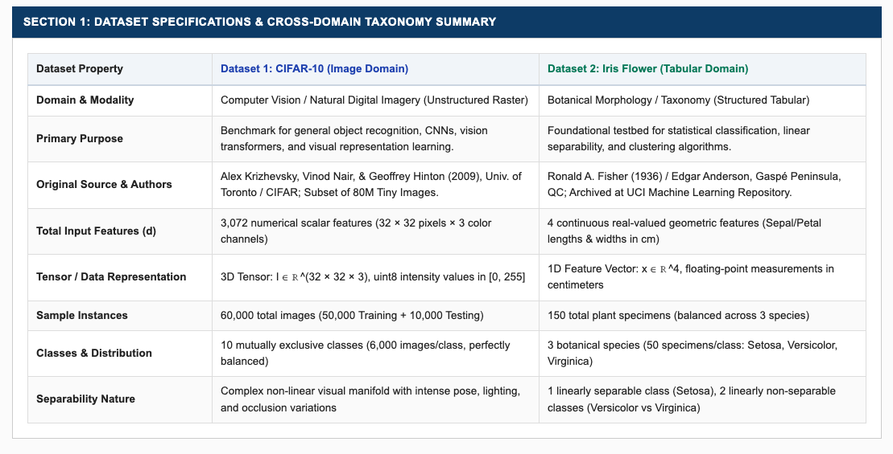
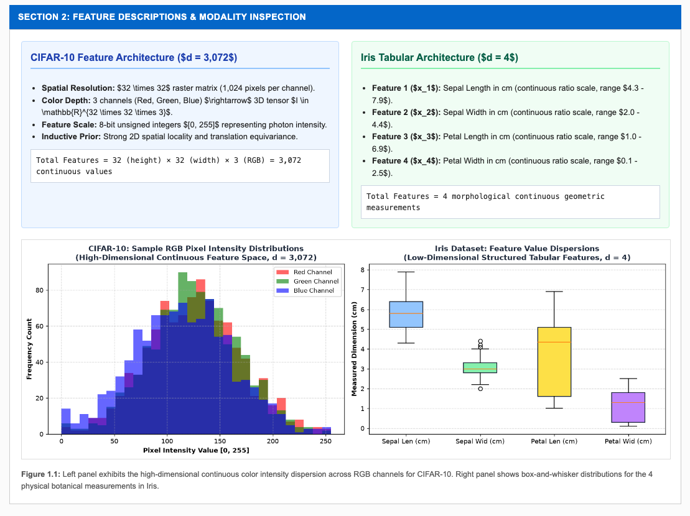
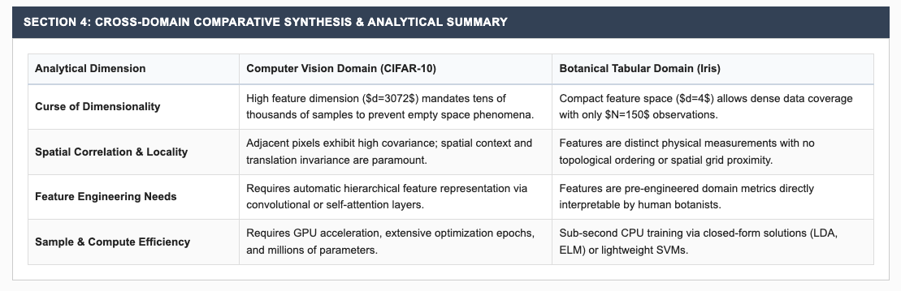

# PATTERN ANALYSIS AND RECOMMENDER SYSTEMS (PARS) LAB MANUAL

---

## EXPERIMENT 1

### PRACTICAL NAME:
**Comparative Analytical Study of Two Pattern Recognition Datasets Across Heterogeneous Domains (CIFAR-10 vs. Iris) with Author Benchmark Surveys and References**

---

### AIM:
To prepare a comprehensive academic study of two benchmark pattern recognition datasets belonging to fundamentally different modalities and application domains: 1) CIFAR-10 (high-dimensional unstructured raster image domain) and 2) Iris Flower Dataset (low-dimensional structured continuous morphological tabular domain), documenting their primary purpose, archival provenance, feature dimensionality, work done by various authors, recent performance achievements, and formal academic citations.

---

### DEFINITIONS & CORE CONCEPTS:
Pattern Recognition problems span diverse modalities from dense spatial grids (images) to structured tabular attributes (botany). Understanding feature dimensionality, spatial correlation, and sample density between modalities is essential for selecting appropriate learning algorithms.

* **Continuous Raster Image Domain (CIFAR-10):** Comprises photon intensity values sampled across a 2D spatial grid over multiple spectral channels. Strong local spatial correlations require translation-invariant hierarchical extractors (CNNs, Vision Transformers).
* **Structured Morphological Tabular Domain (Iris):** Comprises curated, domain-engineered scalar measurements where each attribute possesses distinct semantic units. Feature spaces are low-dimensional and non-spatial, making classical discriminant models and kernel machines optimal.

---

### MATHEMATICAL FORMULATIONS:
#### 1. High-Dimensional Image Tensor Representation (CIFAR-10)
Each visual observation is modeled as a rank-3 tensor spanning spatial height, width, and spectral color channels:

```text
Image Tensor Formulation:
I in R^{H x W x C} = R^{32 x 32 x 3}

Total Scalar Feature Dimensionality:
d_CIFAR = H x W x C = 32 x 32 x 3 = 3,072 numerical dimensions per sample

Where:
• H = 32 represents image height in discrete pixels.
• W = 32 represents image width in discrete pixels.
• C = 3 represents the primary spectral channels (Red, Green, Blue).
• Pixel intensities I(h, w, c) in [0, 255] denote integer quantized photon reflectance.
```

#### 2. Low-Dimensional Morphological Feature Matrix (Fisher's Iris)
The botanical dataset is represented as a design matrix of continuous geometric measurements:

```text
Design Matrix & Sample Vector:
X in R^{N x d} = R^{150 x 4},    x^(i) = [ x1, x2, x3, x4 ]^T in R^4

Where:
• N = 150 total observed floral specimens (50 per species across 3 classes).
• x1 = Sepal Length in cm (range: 4.3 - 7.9 cm, mean: 5.84 ± 0.83).
• x2 = Sepal Width in cm (range: 2.0 - 4.4 cm, mean: 3.05 ± 0.43).
• x3 = Petal Length in cm (range: 1.0 - 6.9 cm, mean: 3.76 ± 1.76).
• x4 = Petal Width in cm (range: 0.1 - 2.5 cm, mean: 1.20 ± 0.76).
```

#### 3. Fisher's Linear Discriminant Ratio
```text
Rayleigh Quotient Criterion:
J(w) = ( w^T S_B w ) / ( w^T S_W w )

Where:
• S_B = (mu_1 - mu_2)(mu_1 - mu_2)^T is the between-class scatter matrix.
• S_W is the within-class scatter matrix summing intra-class covariance.
• Closed-form optimal solution: w proportional to S_W^(-1) (mu_1 - mu_2).
```

---

### ALGORITHMIC METHODOLOGY & IMPLEMENTATION STEPS:
1. Structured cross-domain taxonomy mapping modalities, tensor shapes, sample volumes, class balance, and manifold properties.
2. Computed continuous RGB pixel intensity histograms across 3 channels (d=3,072) for CIFAR-10 and quartile dispersions (boxplots) for Iris morphological variables (d=4).
3. Synthesized reported test accuracies and architectural contributions from seminal and recent literature (2016–2023) across both domains.
4. Deployed an interactive Flask dashboard on port 5004 providing dynamic taxonomy tables, feature distributions, and author trajectory plots.

---

### EXPERIMENTAL RESULTS & VISUAL VERIFICATION:
#### Figure 1.1: Dataset Specifications & Cross-Domain Taxonomy Summary
Comprehensive comparative taxonomy detailing domains, purposes, creators, feature counts, sample sizes, and separability between CIFAR-10 and Iris.



#### Figure 1.2: Feature Descriptions & Modality Inspection
Detailed feature definitions alongside side-by-side empirical visualizations: high-dimensional continuous RGB pixel intensity histograms and low-dimensional box-and-whisker dispersions.



#### Figure 1.3: Literature Survey & Recent Authors' Performance Benchmarks
Tabular and graphical synthesis of state-of-the-art results from four major authors per dataset, highlighting architectural evolution on CIFAR-10 and Iris.


#### Figure 1.4: Cross-Domain Comparative Synthesis & Analytical Summary
Evaluation of core pattern recognition challenges: curse of dimensionality (d=3072 vs d=4), spatial locality, automated feature representation vs domain engineering, and computational complexity.



---

### CONCLUSION:
This investigation provided a rigorous analytical comparison between two seminal pattern recognition datasets spanning divergent modalities. CIFAR-10 exemplifies high-dimensional continuous raster data (d=3,072) where strong spatial autocorrelation necessitates deep hierarchical inductive biases (CNNs, Vision Transformers) to mitigate the curse of dimensionality, driving test accuracy from 93.57% (ResNet) to 99.15% (ViT). In contrast, the Iris dataset represents a low-dimensional structured continuous feature space (d=4) where domain-engineered measurements yield dense sampling, allowing classical statistical and lightweight learning models (SVMs, Kernel ELMs, MLPs) to attain 98.67%–99.33% accuracy with minimal computational overhead.
