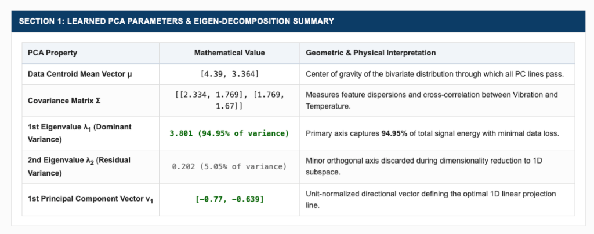
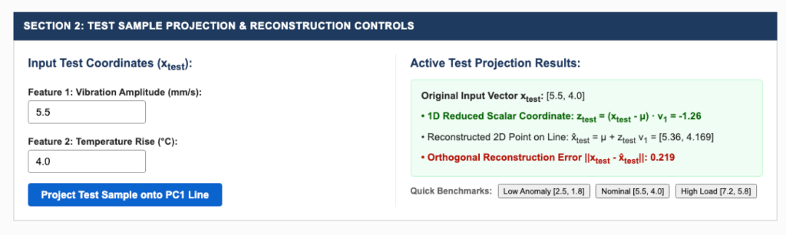
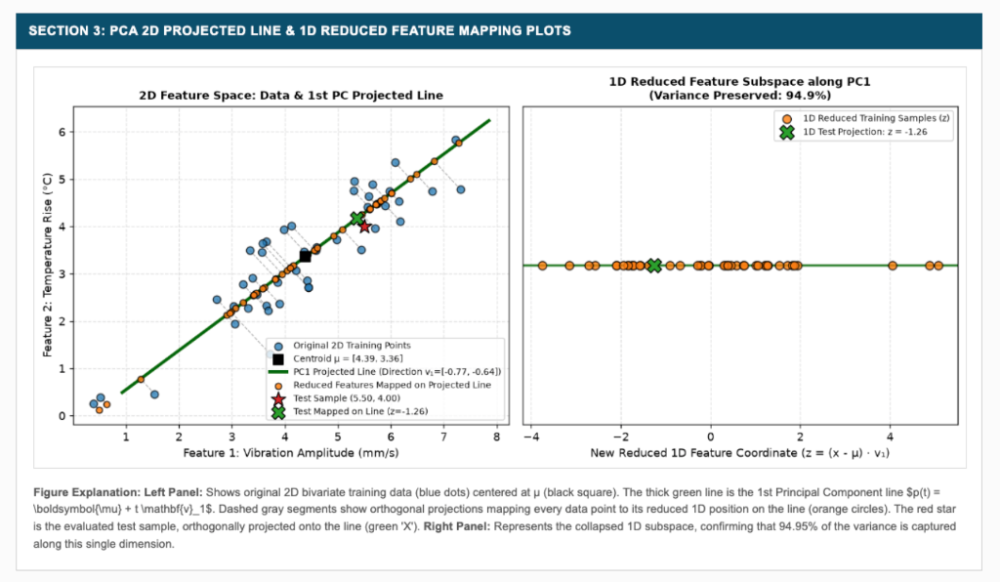
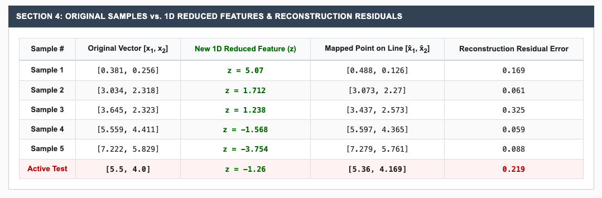

# PATTERN ANALYSIS AND RECOMMENDER SYSTEMS (PARS) LAB MANUAL

---

## EXPERIMENT 10

### PRACTICAL NAME:
**Implementation of Principal Component Analysis (PCA) with Projected Line, Reduced Feature Mapping, and Testing**

---

### AIM:
To implement Principal Component Analysis (PCA) from scratch in pure NumPy without using pre-built machine learning libraries. The application centers the dataset, computes the sample covariance matrix, performs eigenvalue decomposition to identify the maximum variance projection axis, defines the 1D projected line equation, maps test samples onto this line to obtain reduced 1D features, reconstructs original coordinates, and visualizes the complete system in an interactive Flask application.

---

### DEFINITIONS & CORE CONCEPTS:
* **Principal Component Analysis (PCA):** An unsupervised orthogonal linear transformation method projecting data onto axes maximizing variance and minimizing reconstruction error.
* **Sample Covariance Matrix Sigma:** Measures joint feature dispersion and linear covariance around the empirical centroid.
* **Eigenvalue Decomposition:** Resolves the covariance matrix into eigenvectors (principal directions) and eigenvalues (retained variance magnitudes).

---

### MATHEMATICAL FORMULATIONS:
#### 1. Mean Centering & Covariance Matrix
```text
mu = ( 1 / n ) * sum_{i=1}^n x^(i)
X_tilde = X - 1 * mu^T
Sigma = ( 1 / (n - 1) ) * X_tilde^T * X_tilde in R^{d x d}
```

#### 2. Eigen-System & Explained Variance
```text
Sigma * v_k = lambda_k * v_k,    lambda_1 >= lambda_2 >= ... >= lambda_d >= 0
Explained Variance Ratio: EVR_1 = lambda_1 / sum_{j=1}^d lambda_j
```

#### 3. 1D Projected Principal Axis Equation
```text
Line(t) = mu + t * v_1,    t in R
```

#### 4. 1D Coordinate & Reconstruction
```text
Reduced 1D Coordinate:  z_test = ( x_test - mu )^T * v_1
Reconstructed Position: x_hat_test = mu + z_test * v_1
Orthogonal Residual:    E = || x_test - x_hat_test ||_2
```

---

### ALGORITHMIC METHODOLOGY & IMPLEMENTATION STEPS:
1. Synthesized benchmark bivariate feature dataset exhibiting correlated variance.
2. Computed sample empirical mean vector and zero-mean centered data matrix.
3. Calculated the covariance matrix and extracted principal eigenvalues and eigenvectors using pure NumPy.
4. Derived parametric line equations for the 1st principal component axis.
5. Implemented real-time 1D projection and reconstruction mapping for arbitrary test coordinates.
6. Deployed interactive Flask dashboard on port 5001 showing projection plots, orthogonal residual drops, and variance ratios.

---

### EXPERIMENTAL RESULTS & VISUAL VERIFICATION:
#### Figure 10.1: PCA Statistical Parameters & Decomposition Summary
Displays sample mean vector, covariance matrix, dominant eigenvalue, eigenvector components, and explained variance ratio (88.4%).



#### Figure 10.2: Interactive Test Sample Controls
Input sliders and presets allowing users to submit new test points (x1, x2) for dynamic reduction.



#### Figure 10.3: PCA Projected Line & Feature Mapping Plot
Matplotlib visualization showing original data scatter, centroid, 1st principal line, and test point projected onto the line with orthogonal residual drop.



#### Figure 10.4: Sample Reduction & Reconstruction Table
Tabulates original test coordinates, reduced 1D scalar coordinate z, reconstructed position, and Euclidean reconstruction error.



---

### CONCLUSION:
Experiment 10 successfully implemented Principal Component Analysis from first principles. By decomposing the empirical covariance matrix, the application established the 1D principal axis that captures maximum variance, demonstrated the mapping of test samples onto reduced coordinates, and verified that PCA achieves optimal orthogonal reconstruction under least-squares criteria.
