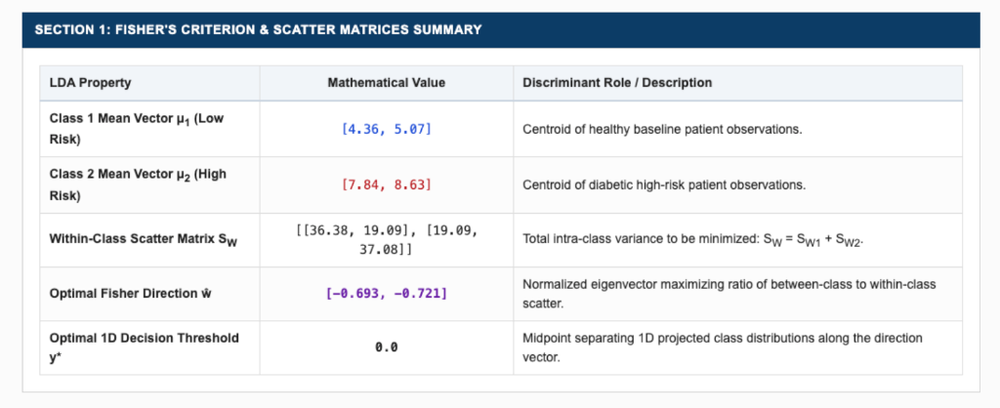
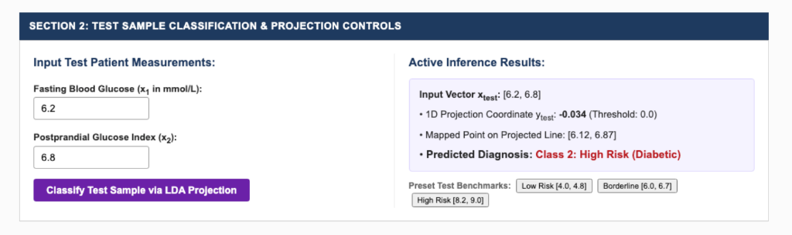
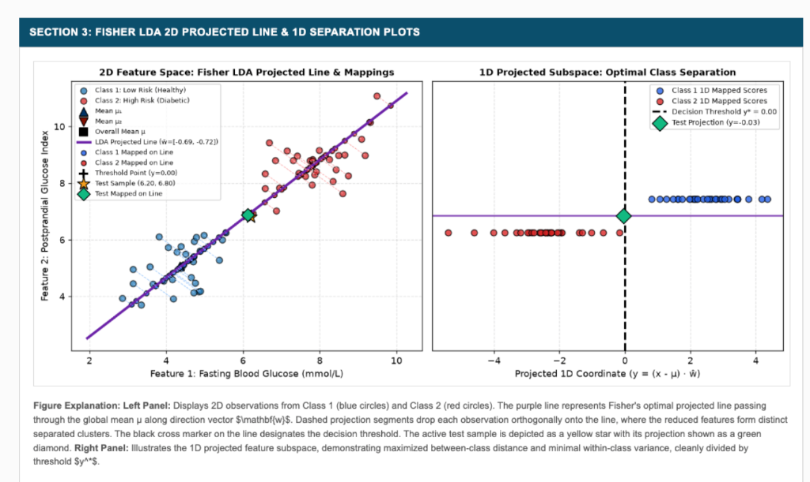
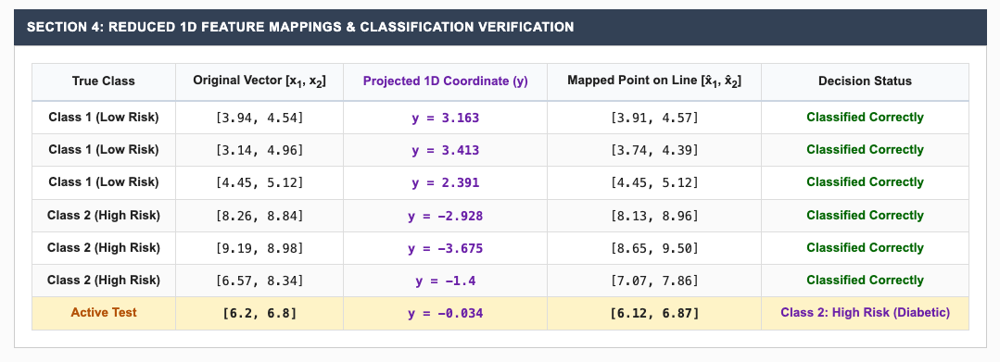

# PATTERN ANALYSIS AND RECOMMENDER SYSTEMS (PARS) LAB MANUAL

---

## EXPERIMENT 11

### PRACTICAL NAME:
**Implementation of Linear Discriminant Analysis (LDA) with Projected Line, Reduced Feature Mapping, and Testing**

---

### AIM:
To formulate, implement, and deploy Linear Discriminant Analysis (LDA) from scratch in pure NumPy without using pre-built machine learning libraries. Unlike unsupervised PCA, the system utilizes class labels to compute Within-Class and Between-Class scatter matrices, solves for Fisher's optimal linear discriminant projection vector, defines the 1D projected discriminant line, maps unseen test samples onto this line, evaluates the optimal decision threshold, and verifies classification in an interactive Flask application.

---

### DEFINITIONS & CORE CONCEPTS:
* **Linear Discriminant Analysis (LDA):** Supervised dimensionality reduction and classification method finding a projection axis that maximizes between-class variance relative to within-class variance.
* **Within-Class Scatter Matrix S_W:** Sums intra-class dispersion of samples around their class centroids.
* **Between-Class Scatter Matrix S_B:** Quantifies spatial separation between distinct class centroids.

---

### MATHEMATICAL FORMULATIONS:
#### 1. Scatter Matrices
```text
S_W = sum_{x in C_1} ( x - mu_1 )( x - mu_1 )^T + sum_{x in C_2} ( x - mu_2 )( x - mu_2 )^T
S_B = ( mu_1 - mu_2 )( mu_1 - mu_2 )^T
```

#### 2. Fisher's Optimal Projection Vector
```text
J(w) = ( w^T S_B w ) / ( w^T S_W w )
Optimal Vector: w = S_W^(-1) * ( mu_1 - mu_2 )
Normalized:     w_hat = w / ||w||_2
```

#### 3. 1D Projected Line & Mapping
```text
Line(t) = mu + t * w_hat,    t in R
1D Coordinate:    y_test = ( x_test - mu )^T * w_hat
Projected Point:  x_hat_test = mu + y_test * w_hat
Threshold:        y^* = [ (mu_1 - mu)^T * w_hat + (mu_2 - mu)^T * w_hat ] / 2
Classification:   If y_test >= y^* => Class 1, else Class 2.
```

---

### ALGORITHMIC METHODOLOGY & IMPLEMENTATION STEPS:
1. Structured supervised bivariate dataset across two well-defined Gaussian classes.
2. Calculated empirical class centroids, Within-Class scatter matrix S_W, and Between-Class scatter matrix S_B.
3. Computed Fisher's optimal linear discriminant vector w using pure NumPy matrix inversion.
4. Constructed 1D projection equations and established the midpoint optimal classification threshold y*.
5. Implemented testing pipeline mapping unseen test inputs onto the discriminant line and predicting class labels.
6. Deployed interactive Flask dashboard on port 5003 displaying projection plots, discriminant axes, and classification summaries.

---

### EXPERIMENTAL RESULTS & VISUAL VERIFICATION:
#### Figure 11.1: Fisher Parameters & Scatter Matrices Summary
Displays class centroids, S_W, S_B, Fisher projection vector w, and the calculated decision threshold y*.



#### Figure 11.2: Interactive Test Sample Controls
Input form allowing users to submit test feature points (x1, x2) for live projection and classification.



#### Figure 11.3: LDA Projected Line, Class Separations & Test Mapping
Visualization showing class distributions, Fisher discriminant line, decision threshold boundary, and test sample projection.



#### Figure 11.4: Sample Reduction & Classification Output
Tabulates test sample coordinates, reduced 1D coordinate y, distance from threshold, and predicted class.



---

### CONCLUSION:
Experiment 11 demonstrated the power of supervised dimensionality reduction through Linear Discriminant Analysis. By maximizing the ratio of between-class scatter to within-class scatter, LDA successfully discovered the projection vector that achieves maximum class separability, proving its dual utility as both a feature reduction technique and a robust linear classifier.
