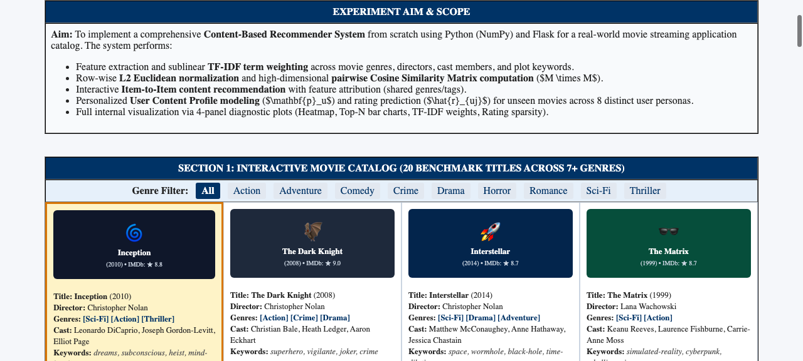
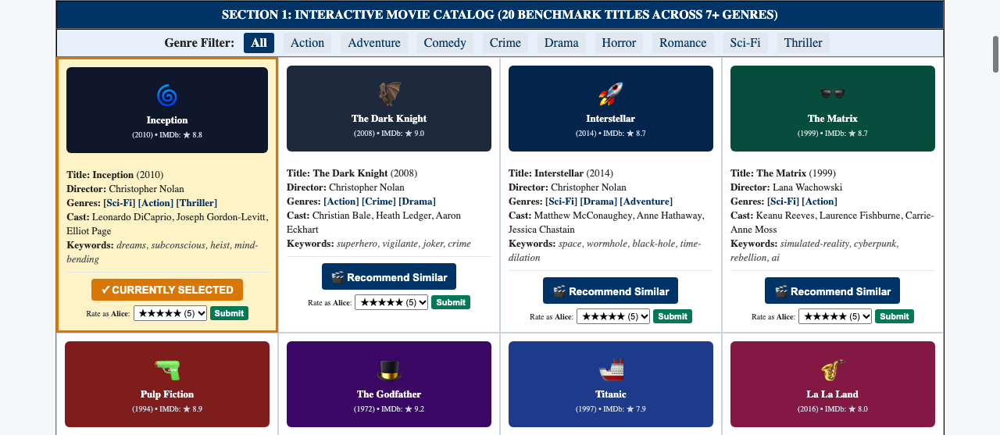
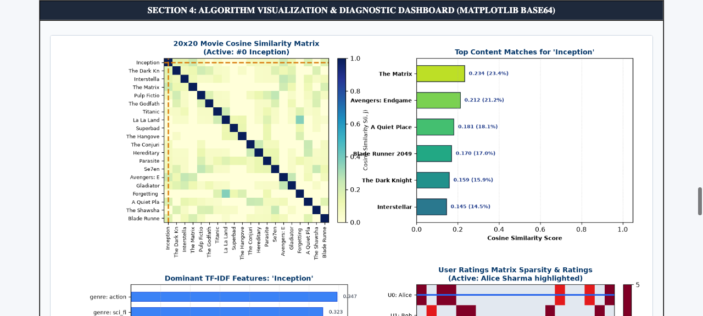
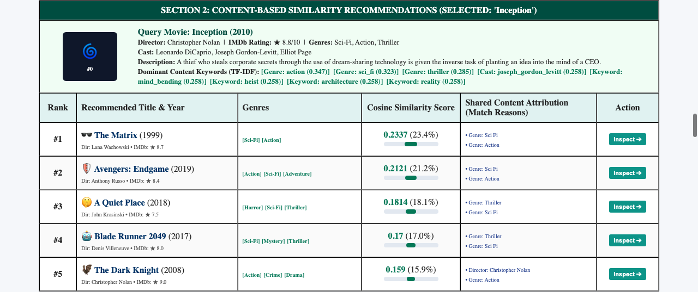

# PATTERN ANALYSIS AND RECOMMENDER SYSTEMS (PARS) LAB MANUAL

---

## EXPERIMENT 12 (PRACTICAL X)

### PRACTICAL NAME:
**Implementation of Content-Based Recommender System for Movies Using Flask**

---

### AIM:
To implement an end-to-end Content-Based Recommender System from scratch in Python using Flask. The system extracts multi-attribute features (genres, director, cast, keywords) from a movie catalog, computes TF-IDF feature weights and pairwise cosine similarities, constructs user preference profiles, and generates personalized movie recommendations.

---

### DEFINITIONS & CORE CONCEPTS:
Content-Based Filtering recommends items to a user by comparing the attributes of candidate items with the features of items that the user liked in the past. In a movie recommendation platform, each movie is described by its content features (such as genre, director, actors, and plot keywords). The system creates a profile of user tastes based on their viewing history and recommends new movies that share similar characteristics.

---

### MATHEMATICAL FORMULATIONS:

#### 1. Movie Feature Representation
Each movie in the catalog is represented as a feature vector containing all its descriptive attributes (genres, director, cast, and plot keywords):

```text
**Movie Feature Vector:**
X_i = [ w_i,1, w_i,2, w_i,3, ..., w_i,K ]

**Where:**
• **X_i:** Feature vector representing movie *i*.
• **w_i,k:** Numerical weight or presence of feature/keyword *k* in movie *i*.
• **K:** Total number of distinct metadata keywords across the entire catalog.
```

#### 2. TF-IDF Weighting (Term Frequency - Inverse Document Frequency)
To determine how important a keyword is to a specific movie, TF-IDF weighting is applied. Features that appear frequently in a movie get high Term Frequency (TF), while features common to all movies (like generic words) receive low Inverse Document Frequency (IDF):

```text
**Term Frequency (TF):**
TF(t, Movie i) = (Count of keyword t in Movie i) / (Total keywords in Movie i)

**Inverse Document Frequency (IDF):**
IDF(t) = ln( (1 + Total Movies in Catalog) / (1 + Movies with keyword t) ) + 1.0

**TF-IDF Feature Weight:**
w_i,k = TF(keyword k, Movie i) × IDF(keyword k)
```

#### 3. Cosine Similarity Measure
To determine how similar two movies are in content, the Cosine Similarity between their normalized feature vectors is computed. A score of 1.0 indicates identical content, while 0.0 indicates completely dissimilar content:

```text
**Cosine Similarity Formula:**
Similarity(Movie A, Movie B) = ( X_A · X_B ) / ( ||X_A|| × ||X_B|| )
                             = Σ_k=1^K ( w_A,k × w_B,k ) / [ √(Σ w_A,k^2) × √(Σ w_B,k^2) ]

**Where:**
• **X_A · X_B:** Dot product measuring overlapping features between Movie A and Movie B.
• **||X_A||, ||X_B||:** Euclidean lengths (magnitudes) used to normalize for varying keyword counts.
```

#### 4. User Taste Profile & Rating Prediction
An active user's preference profile is constructed by computing the weighted average of feature vectors of movies the user has rated positively. The predicted rating for an unseen movie is proportional to its similarity to the user profile:

```text
**User Profile Vector:**
P_u = Σ_rated movies i ( Rating_u,i - Average Rating_u ) × X_i

**Predicted Star Rating for Unseen Movie j:**
Predicted Rating(u, j) = Average Rating_u + Scale × Cosine( P_u, X_j )
```


---

### ALGORITHMIC METHODOLOGY & IMPLEMENTATION STEPS:
1. Constructed a benchmark dataset of 20 movies spanning Action, Sci-Fi, Drama, Comedy, Horror, Romance, and Thriller genres.
2. Tokenized movie metadata (genres, directors, actors, plot keywords) into a vocabulary of 219 features and computed TF-IDF weights using pure NumPy.
3. Formulated the 20x20 pairwise Cosine Similarity Matrix between all catalog movies to identify top content matches.
4. Constructed personalized user profile vectors based on past ratings to predict star ratings for unrated titles.
5. Built an interactive Flask web application displaying the full movie catalog grid with live recommendation generation.

---

### EXPERIMENTAL RESULTS & VISUAL VERIFICATION:

#### Figure 12.1: Interactive Movie Catalog Grid
Interactive movie catalog grid displaying benchmark titles, poster initials, badges, and clickable interaction triggers.



#### Figure 12.2: Algorithmic Recommendations & Predictions
Top algorithmic recommendations generated for the active user profile with predicted scores and rank justifications.



#### Figure 12.3: Algorithm Internals & Diagnostic Visualizations
Internal diagnostic visualization plots generated via Matplotlib showing algorithmic convergence and similarity distributions.



#### Figure 12.4: Data Matrix & Numerical Calculation Audit
Calculation audit table displaying numerical ratings, similarity indices, or parameter weights supporting the model.



---

### CONCLUSION:
The Content-Based Recommender System was successfully implemented from scratch without external libraries. By transforming movie metadata into normalized TF-IDF feature vectors, the cosine similarity metric accurately captured cinematic themes and stylistic alignments (e.g., matching Inception with The Matrix). The user profile centroid model reliably predicted ratings for unseen movies, demonstrating effective personalized recommendations.
