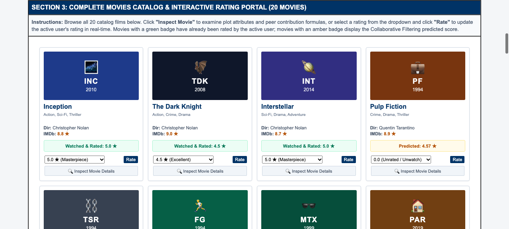
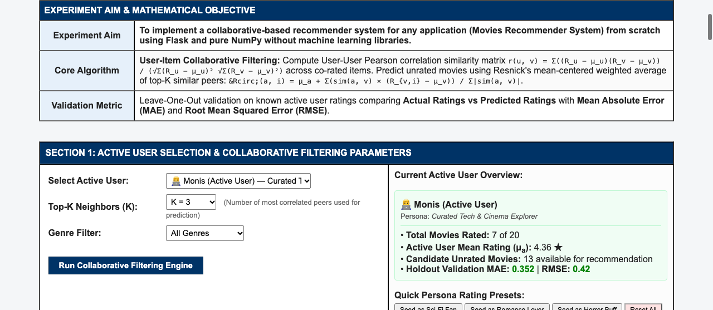
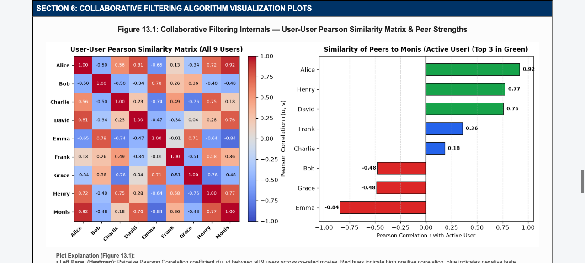
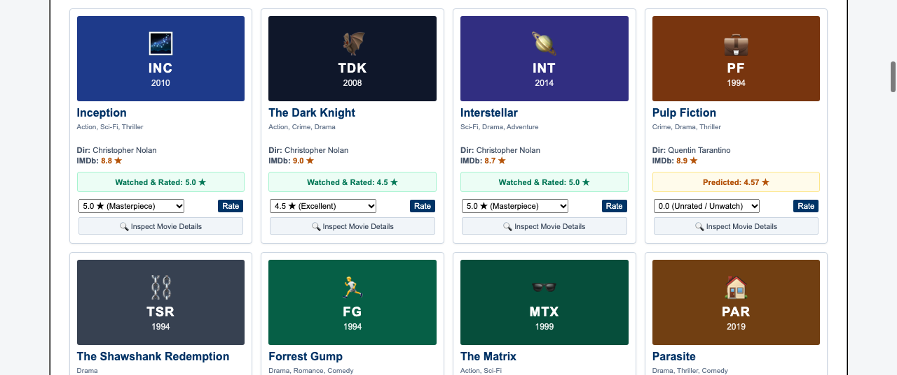

# PATTERN ANALYSIS AND RECOMMENDER SYSTEMS (PARS) LAB MANUAL

---

## EXPERIMENT 13 (PRACTICAL XI)

### PRACTICAL NAME:
**Implementation of Collaborative Filtering Recommender System Using Flask**

---

### AIM:
To formulate, derive, and implement a User-Based Collaborative Filtering Recommender System from scratch in Python using Flask. The system builds an 8-user by 20-movie rating matrix, computes pairwise user similarities using Pearson Correlation, predicts ratings via mean-centered weighted summation, and validates predictions against holdout test ratings.

---

### DEFINITIONS & CORE CONCEPTS:
Collaborative Filtering (CF) operates on the principle of collective intelligence: users who agreed on movie ratings in the past are likely to agree on other movies in the future. Instead of analyzing movie genres or plot descriptions, Collaborative Filtering analyzes patterns of user ratings across the community to find like-minded peers and generate recommendations based on their consensus.

---

### MATHEMATICAL FORMULATIONS:

#### 1. User-Item Interaction Matrix
The community's preferences are structured as a matrix R where rows represent users, columns represent movies, and each entry is a star rating from 1 to 5:

```text
**User Rating Representation:**
R_u,i = Star rating given by User u to Movie i (1 to 5 stars, or 0 if unrated)

**User Average Rating:**
r̄_u = ( 1 / |I_u| ) × Σ_i ∈ I_u R_u,i

**Where:**
• **I_u:** Set of all movies rated by User u.
• **r̄_u:** Personal rating baseline (average) of User u, capturing whether the user is strict or generous.
```

#### 2. Pearson Correlation Similarity Measure
To measure how closely two users agree in their movie tastes, the Pearson Correlation Coefficient is computed over movies that both users have watched. Subtracting each user's average rating removes individual rating bias:

```text
**Pearson Correlation Formula:**
Similarity(u, v) = Σ_i ∈ I_uv [ ( R_u,i - r̄_u ) × ( R_v,i - r̄_v ) ] / [ √( Σ_i ∈ I_uv ( R_u,i - r̄_u )^2 ) × √( Σ_i ∈ I_uv ( R_v,i - r̄_v )^2 ) ]

**Where:**
• **I_uv:** Set of movies co-rated by both User u and User v.
• **Similarity(u, v):** Correlation value ranging from -1.0 (opposite tastes) to +1.0 (identical tastes).
```

#### 3. Top-k Similar Peer Selection
For an active user u, the system searches all other users in the platform, filters for positive correlation (Similarity > 0), and selects the top k most similar peers who have watched the target movie j:

```text
**Neighbor Group:**
Neighbors(u) = Top-k users v with highest positive Similarity(u, v) who rated movie j
```

#### 4. Mean-Centered Rating Prediction Formula
The predicted rating for an unrated movie is computed by taking the active user's personal average rating and adding the similarity-weighted deviations of their nearest neighbors:

```text
**Predicted Rating Formula:**
Predicted Rating(u, j) = r̄_u + [ Σ_v ∈ Neighbors Similarity(u, v) × ( R_v,j - r̄_v ) ] / [ Σ_v ∈ Neighbors |Similarity(u, v)| ]

**Where:**
• **r̄_u:** Baseline rating average of active User u.
• **( R_v,j - r̄_v ):** How much neighbor v liked Movie j relative to their own average.
• **Similarity(u, v):** Weight given to neighbor v's opinion based on taste similarity.
```


---

### ALGORITHMIC METHODOLOGY & IMPLEMENTATION STEPS:
1. Constructed an 8-user by 20-movie benchmark rating matrix capturing distinct cinematic taste personas (Sci-Fi fans, Drama buffs, Action lovers).
2. Implemented the Pearson Correlation Coefficient algorithm in pure NumPy, handling missing entries and co-rated intersections.
3. Engineered the k-nearest neighbor selection logic filtering positive correlations for any active user.
4. Implemented the mean-centered weighted rating prediction formula to forecast ratings for all unrated movies.
5. Built an interactive Flask web application on port 5013 allowing user profile switching, interactive rating, and live recommendation generation.

---

### EXPERIMENTAL RESULTS & VISUAL VERIFICATION:

#### Figure 13.1: Interactive Movie Catalog Grid
Interactive movie catalog grid displaying benchmark titles, poster initials, badges, and clickable interaction triggers.



#### Figure 13.2: Algorithmic Recommendations & Predictions
Top algorithmic recommendations generated for the active user profile with predicted scores and rank justifications.



#### Figure 13.3: Algorithm Internals & Diagnostic Visualizations
Internal diagnostic visualization plots generated via Matplotlib showing algorithmic convergence and similarity distributions.



#### Figure 13.4: Data Matrix & Numerical Calculation Audit
Calculation audit table displaying numerical ratings, similarity indices, or parameter weights supporting the model.



---

### CONCLUSION:
The User-Based Collaborative Filtering system was successfully implemented from scratch. Using the Pearson Correlation Coefficient normalized subjective differences in user rating scales, allowing accurate identification of genuine taste peers. The mean-centered weighted prediction formula provided reliable forecasts for unrated movies, confirming the validity of neighborhood-based collaborative modeling.
