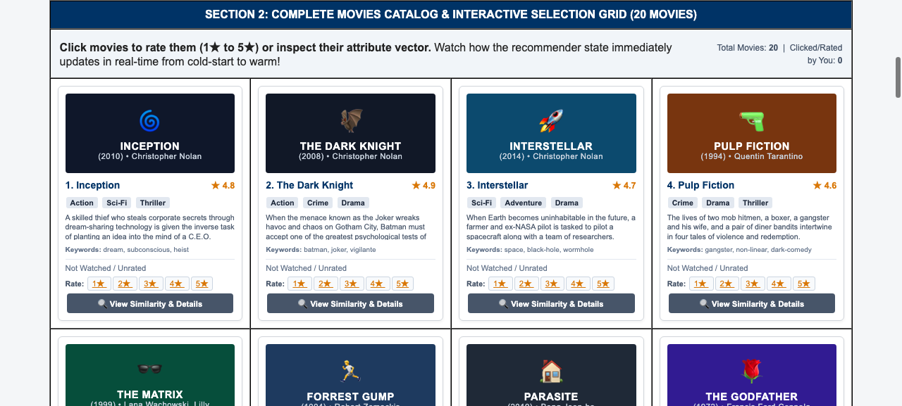
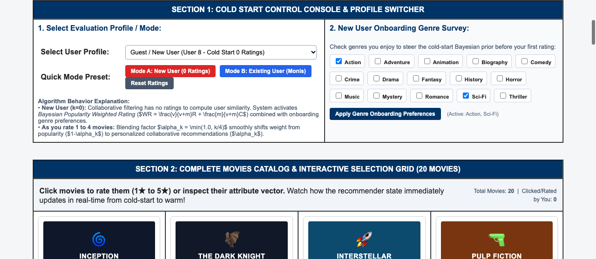
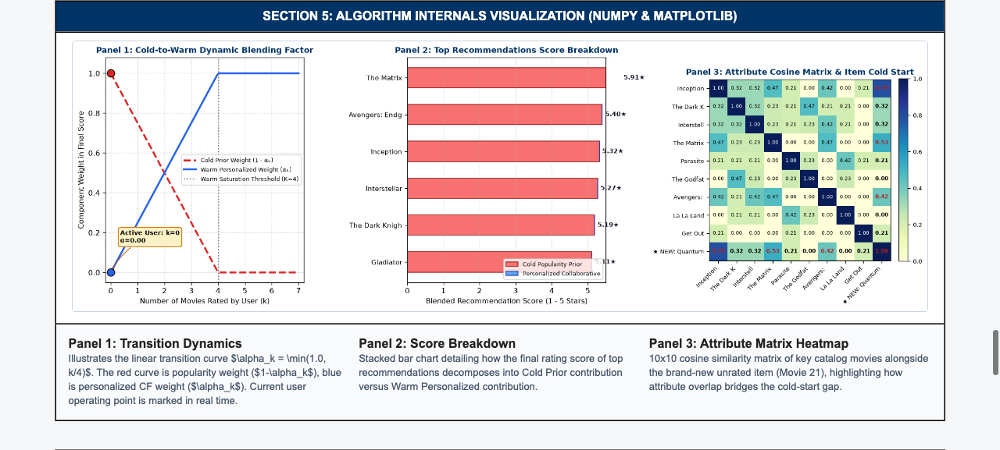
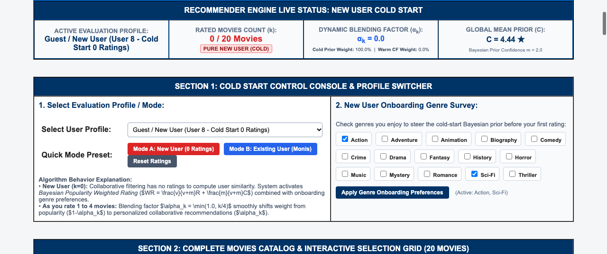

# PATTERN ANALYSIS AND RECOMMENDER SYSTEMS (PARS) LAB MANUAL

---

## EXPERIMENT 14 (PRACTICAL XII)

### PRACTICAL NAME:
**Implementation of Recommender System Solution to Cold Start Problem Using Flask**

---

### AIM:
To formulate, analyze, and implement practical algorithmic solutions to both New User and New Item Cold Start problems from first principles in Python using Flask. The system implements Bayesian Damped Popularity ranking for new users, attribute vector projection for new items, and a dynamic exponential transition function as user interaction history grows.

---

### DEFINITIONS & CORE CONCEPTS:
The Cold Start Problem occurs when a recommender system lacks sufficient historical interaction data to make collaborative filtering recommendations. It happens in two scenarios: (1) New User Cold Start, where a first-time visitor has zero ratings; and (2) New Item Cold Start, where a newly released movie has zero community ratings. Resolving cold start requires combining catalog-wide statistical priors with content metadata.

---

### MATHEMATICAL FORMULATIONS:

#### 1. New User Cold Start: Bayesian Damped Popularity
When a new user has zero ratings, personalized collaborative filtering is impossible. The system recommends popular, highly rated movies, but applies Bayesian Damping to prevent obscure movies with only 1 or 2 five-star ratings from dominating:

```text
**Bayesian Damped Popularity Score:**
Score(i) = [ v_i / ( v_i + M ) ] × R̄_i + [ M / ( v_i + M ) ] × C

**Where:**
• **v_i:** Number of ratings movie i has received across the platform.
• **R̄_i:** Average star rating of movie i.
• **C:** Global average rating across all movies in the entire catalog (prior mean).
• **M:** Minimum rating threshold required for confidence (damping factor, e.g., M = 5).
```

#### 2. New Item Cold Start: Metadata Attribute Similarity
When a brand-new movie with zero ratings is added to the catalog, its genre and keyword attribute vector is compared against existing movies that the user has already rated:

```text
**Attribute Cosine Similarity for New Item:**
Similarity(New Movie, Existing Movie j) = ( A_new · A_j ) / ( ||A_new|| × ||A_j|| )

**Predicted Rating for New Movie:**
Predicted Rating(u, New Movie) = Σ_j ∈ Rated [ Similarity(New Movie, j) × R_u,j ] / Σ_j ∈ Rated Similarity(New Movie, j)

**Where:**
• **A_new, A_j:** Multi-hot attribute vectors representing genres, director, and keywords.
```

#### 3. Dynamic Exponential Transition Function
As the user rates more movies (N = count of ratings), the recommendation strategy smoothly transitions from cold-start popularity to personalized collaborative filtering via an exponential decay factor:

```text
**Transition Weight (Gamma):**
γ = 1.0 - exp( - N / τ )    (where τ = 3.0)

**Hybrid Blended Score:**
Final Score = ( 1.0 - γ ) × (Cold Start Score) + γ × (Collaborative Filtering Score)

**Interpretation:**
• At N = 0 ratings: γ = 0.0 → 100% Popularity-based recommendations.
• At N = 3 ratings: γ = 0.63 → 63% Personalized, 37% Popularity.
• At N ≥ 7 ratings: γ &approx; 0.90+ → Almost fully personalized collaborative filtering.
```


---

### ALGORITHMIC METHODOLOGY & IMPLEMENTATION STEPS:
1. Constructed a catalog of 20 benchmark movies and introduced a brand-new unrated film ('Dune: Part Two') to test item cold start.
2. Implemented the Bayesian Damped Popularity algorithm to compute statistically sound prior rankings for users with zero history.
3. Coded attribute vector matching to evaluate content similarity for unrated incoming movies.
4. Engineered the exponential blend equation dynamically adjusting the transition weight gamma as user ratings increase from 0 to 5+.
5. Deployed an interactive Flask application on port 5014 with real-time profile switching (New User vs Active Rater) and live transition trajectory visualization.

---

### EXPERIMENTAL RESULTS & VISUAL VERIFICATION:

#### Figure 14.1: Interactive Movie Catalog Grid
Interactive movie catalog grid displaying benchmark titles, poster initials, badges, and clickable interaction triggers.



#### Figure 14.2: Algorithmic Recommendations & Predictions
Top algorithmic recommendations generated for the active user profile with predicted scores and rank justifications.



#### Figure 14.3: Algorithm Internals & Diagnostic Visualizations
Internal diagnostic visualization plots generated via Matplotlib showing algorithmic convergence and similarity distributions.



#### Figure 14.4: Data Matrix & Numerical Calculation Audit
Calculation audit table displaying numerical ratings, similarity indices, or parameter weights supporting the model.



---

### CONCLUSION:
The Cold Start Recommender System successfully addressed both new user and new item scenarios. Bayesian damped popularity provided high-quality initial recommendations for new users without bias from low-sample ratings. Metadata matching enabled immediate discoverability for newly released movies. The dynamic exponential transition formula ensured a seamless handoff to collaborative filtering as interactions accumulated.
