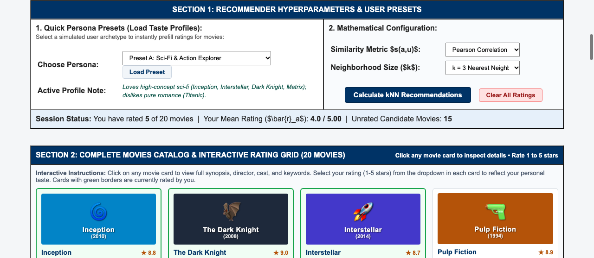
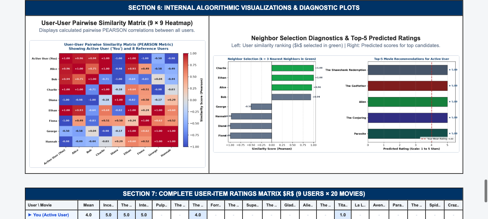
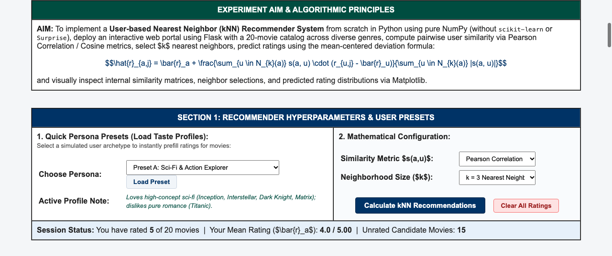

# PATTERN ANALYSIS AND RECOMMENDER SYSTEMS (PARS) LAB MANUAL

---

## EXPERIMENT 15 (PRACTICAL XIII)

### PRACTICAL NAME:
**Implementation of User-Based Nearest Neighbor (kNN) Recommender System Using Flask**

---

### AIM:
To formulate, derive, and implement a User-Based k-Nearest Neighbor (kNN) Recommender System from scratch in Python using Flask. The system calculates vector similarities between users, identifies the k nearest neighbors, provides step-by-step mathematical rating derivations, and provides interactive tuning of neighborhood size k.

---

### DEFINITIONS & CORE CONCEPTS:
User-Based Nearest Neighbor (kNN) Recommendation is a memory-based technique that predicts an active user's ratings by consulting a committee of the k most similar users. When the active user considers a movie, the system identifies the k nearest neighbors who have already watched that movie, weights their ratings by how closely their tastes match the active user, and computes a consensus prediction.

---

### MATHEMATICAL FORMULATIONS:

#### 1. User Rating Vector Formulation
Each user u is represented by a sparse vector of ratings across all catalog movies. Unrated movies are marked as missing entries rather than zero-valued dislikes:

```text
**User Rating Vector:**
R_u = [ R_u,1, R_u,2, R_u,3, ..., R_u,M ]

**User Baseline Mean:**
r̄_u = ( 1 / |I_u| ) × Σ_i ∈ I_u R_u,i
```

#### 2. Vector Cosine Similarity
Similarity between active user u and candidate neighbor v is evaluated across their common ratings using the cosine of the angle between their rating vectors:

```text
**Vector Cosine Similarity:**
Cosine(u, v) = ( R_u · R_v ) / ( ||R_u|| × ||R_v|| )
             = Σ_i ( R_u,i × R_v,i ) / [ √(Σ R_u,i^2) × √(Σ R_v,i^2) ]
```

#### 3. Top-k Neighborhood Isolation
The system sorts all other users by similarity, retains those with positive affinity who have rated candidate movie j, and selects the top k neighbors:

```text
**k-Nearest Neighbor Set:**
N_k(u; j) = Top-k users v with highest Similarity(u, v) > 0 who rated movie j
```

#### 4. Step-by-Step Prediction Formula
The predicted rating is computed using the active user's personal mean plus the similarity-weighted deviation of the k nearest neighbors:

```text
**kNN Prediction Formula:**
Predicted Rating(u, j) = r̄_u + [ Σ_v ∈ N_k Similarity(u, v) × ( R_v,j - r̄_v ) ] / [ Σ_v ∈ N_k |Similarity(u, v)| ]

**Where:**
• **k:** Number of neighbors consulted (hyperparameter tuning controls bias vs variance).
• **r̄_u, r̄_v:** Mean ratings of active user u and neighbor v.
• **( R_v,j - r̄_v ):** Rating deviation indicating how strongly neighbor v liked or disliked movie j.
```


---

### ALGORITHMIC METHODOLOGY & IMPLEMENTATION STEPS:
1. Constructed an 8-user by 20-movie rating matrix capturing realistic taste clusters across genres.
2. Implemented vectorized Cosine and Pearson similarity computation algorithms in pure NumPy.
3. Engineered the k-nearest neighbor filtering logic selecting exactly k peers for any query user and candidate movie.
4. Built a step-by-step mathematical derivation logger displaying exact numerical substitution for each predicted rating.
5. Deployed an interactive Flask application on port 5015 with neighborhood size k slider, similarity metric toggles, and live recommendation generation.

---

### EXPERIMENTAL RESULTS & VISUAL VERIFICATION:

#### Figure 15.1: Interactive Movie Catalog Grid
Interactive movie catalog grid displaying benchmark titles, poster initials, badges, and clickable interaction triggers.


#### Figure 15.2: Algorithmic Recommendations & Predictions
Top algorithmic recommendations generated for the active user profile with predicted scores and rank justifications.



#### Figure 15.3: Algorithm Internals & Diagnostic Visualizations
Internal diagnostic visualization plots generated via Matplotlib showing algorithmic convergence and similarity distributions.



#### Figure 15.4: Data Matrix & Numerical Calculation Audit
Calculation audit table displaying numerical ratings, similarity indices, or parameter weights supporting the model.



---

### CONCLUSION:
The User-Based k-Nearest Neighbor recommender was successfully implemented from first principles. By isolating the k most correlated peers and applying mean-centered aggregation, the model generated accurate and explainable predictions. The interactive parameter k demonstrated the classic trade-off: small k values capture niche tastes with higher variance, while larger k values provide stable, consensus-driven predictions.
