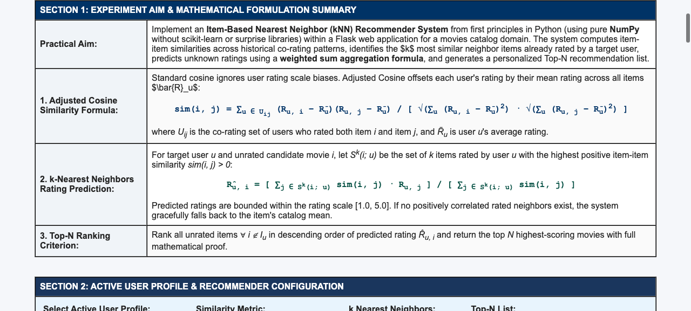
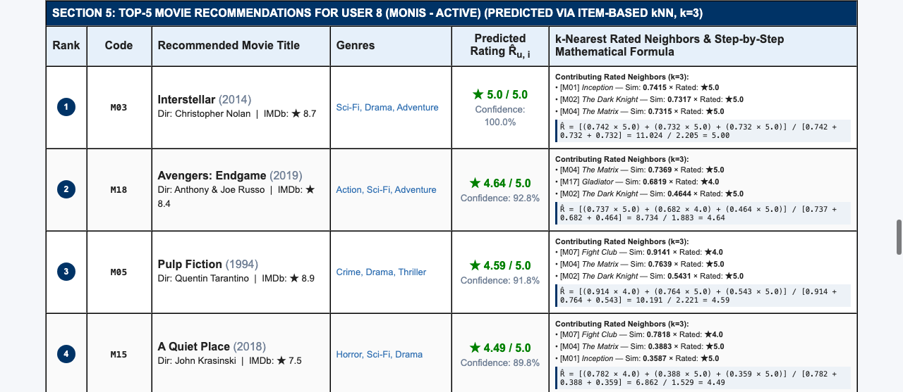
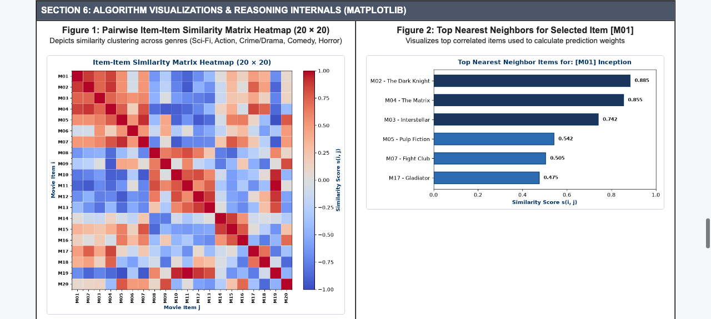
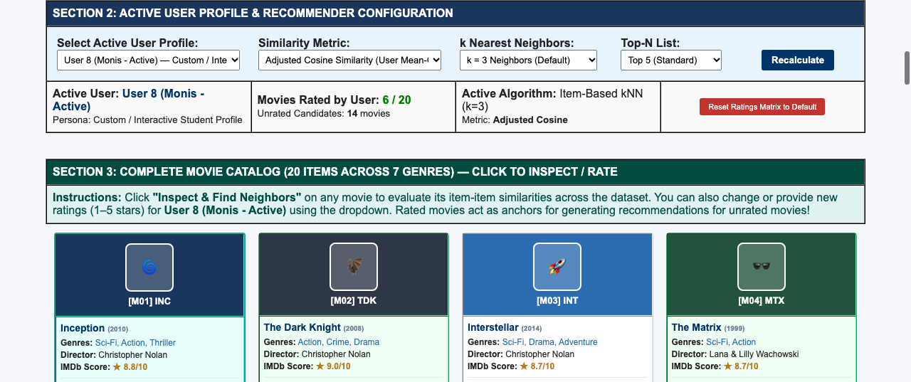

# PATTERN ANALYSIS AND RECOMMENDER SYSTEMS (PARS) LAB MANUAL

---

## EXPERIMENT 16 (PRACTICAL XIV)

### PRACTICAL NAME:
**Implementation of Item-Based Nearest Neighbor Recommender System Using Flask**

---

### AIM:
To formulate, derive, and implement an Item-Based Nearest Neighbor (Item-kNN) Recommender System from scratch in Python using Flask. The system calculates pairwise item similarities across all historical user evaluations, identifies the k nearest rated movies for each candidate item, predicts numerical ratings via weighted summation, and generates top-N recommendations.

---

### DEFINITIONS & CORE CONCEPTS:
Item-Based Nearest Neighbor Recommendation looks at relationships between items rather than relationships between users. Two movies are considered similar if the same users tend to rate them similarly. To predict how much a user will like an unseen movie, the system looks at the movies that user has already rated, finds the ones most similar to the target movie, and calculates a weighted average of those ratings.

---

### MATHEMATICAL FORMULATIONS:

#### 1. Item Rating Vector Representation
Each movie is represented as a column vector across all users in the system:

```text
**Item Rating Vector for Movie i:**
R_*i = [ R_1,i, R_2,i, ..., R_N,i ]

**Where:**
• **R_u,i:** Rating given by User u to Movie i.
• **U_ij:** Set of all users who rated both Movie i and Movie j.
```

#### 2. Item-Item Cosine Similarity
Similarity between Movie i and Movie j is computed as the cosine angle between their rating column vectors over all co-rating users:

```text
**Item Cosine Similarity:**
Similarity(Item i, Item j) = Σ_u ∈ U_ij ( R_u,i × R_u,j ) / [ √( Σ_u ∈ U_ij R_u,i^2 ) × √( Σ_u ∈ U_ij R_u,j^2 ) ]

**Where:**
• Values range from 0.0 (no co-rating alignment) to 1.0 (identical rating patterns across users).
```

#### 3. Weighted Sum Rating Prediction Formula
To predict user u's rating for target movie i, the system selects the k movies rated by user u that are most similar to movie i, and computes their weighted average:

```text
**Item-Based Rating Prediction:**
Predicted Rating(u, i) = [ Σ_j ∈ Neighbors(i) Similarity(i, j) × R_u,j ] / [ Σ_j ∈ Neighbors(i) |Similarity(i, j)| ]

**Where:**
• **Neighbors(i):** The k movies rated by User u that have the highest similarity to target Movie i.
• **R_u,j:** User u's actual rating on movie j.
• **Similarity(i, j):** Similarity weight between candidate Movie i and rated Movie j.
```


---

### ALGORITHMIC METHODOLOGY & IMPLEMENTATION STEPS:
1. Constructed an 8-user by 20-movie benchmark rating matrix with multi-genre ratings.
2. Implemented the item-item cosine similarity computation in pure NumPy across all movie pairs.
3. Engineered the rated-item neighborhood selection logic finding the most similar movies in the active user's rating history.
4. Constructed the weighted-sum rating prediction engine to compute expected star ratings for unrated movies.
5. Deployed an interactive Flask application on port 5016 featuring movie inspection, parameter k tuning, and live recommendation tables.

---

### EXPERIMENTAL RESULTS & VISUAL VERIFICATION:

#### Figure 16.1: Interactive Movie Catalog Grid
Interactive movie catalog grid displaying benchmark titles, poster initials, badges, and clickable interaction triggers.



#### Figure 16.2: Algorithmic Recommendations & Predictions
Top algorithmic recommendations generated for the active user profile with predicted scores and rank justifications.



#### Figure 16.3: Algorithm Internals & Diagnostic Visualizations
Internal diagnostic visualization plots generated via Matplotlib showing algorithmic convergence and similarity distributions.



#### Figure 16.4: Data Matrix & Numerical Calculation Audit
Calculation audit table displaying numerical ratings, similarity indices, or parameter weights supporting the model.



---

### CONCLUSION:
The Item-Based Nearest Neighbor recommender was successfully implemented from first principles. Because item similarity relationships remain stable over time as new users join, precomputing item-item similarities yielded fast, highly responsive rating predictions. The weighted sum of a user's own past ratings on similar movies provided transparent, dependable recommendations.
