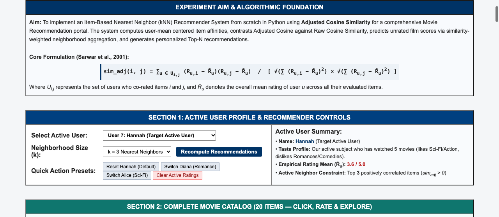
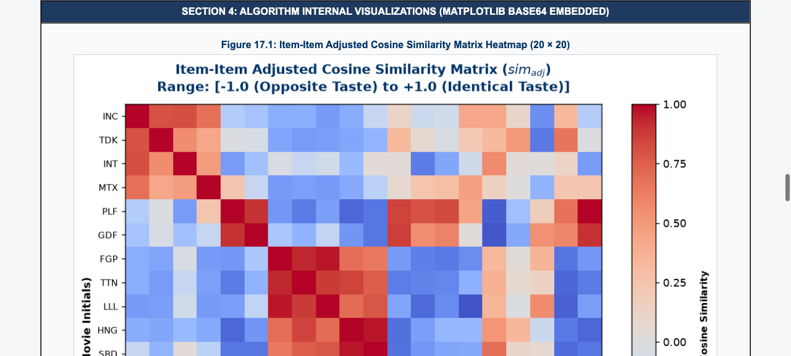
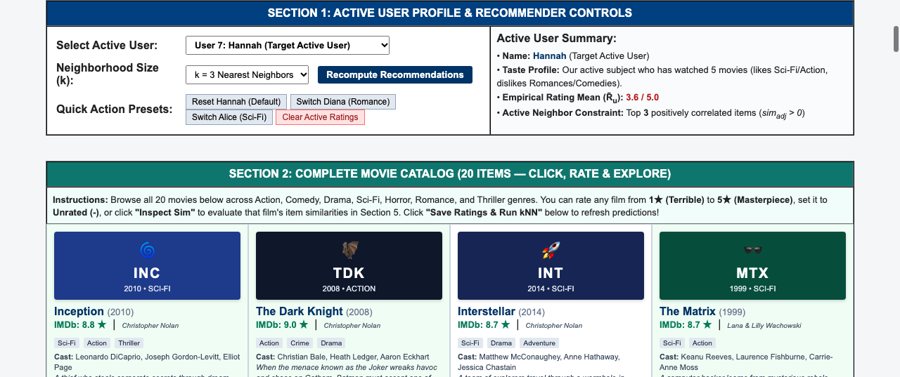

# PATTERN ANALYSIS AND RECOMMENDER SYSTEMS (PARS) LAB MANUAL

---

## EXPERIMENT 17 (PRACTICAL XV)

### PRACTICAL NAME:
**Implementation of Item-Based kNN Recommender System Using Adjusted Cosine Measure in Flask**

---

### AIM:
To formulate, derive, and implement an Item-Based Nearest Neighbor Recommender System using the Adjusted Cosine Measure from first principles in Python using Flask. The experiment contrasts raw cosine similarity against adjusted cosine similarity, mathematically demonstrating how subtracting user mean ratings eliminates subjective rater bias and improves recommendation fidelity.

---

### DEFINITIONS & CORE CONCEPTS:
The Adjusted Cosine Measure is an improved similarity metric for item-based collaborative filtering. Standard cosine similarity treats raw ratings as absolute values and fails to account for the fact that different users have different rating scales (e.g., an overly strict user whose highest rating is 3 versus a generous user whose lowest rating is 4). The Adjusted Cosine measure corrects for this subjective disparity by subtracting each user's average rating from their rating before computing the cosine angle.

---

### MATHEMATICAL FORMULATIONS:

#### 1. Limitation of Standard Raw Cosine Similarity
Standard cosine similarity treats raw star scores as absolute coordinates, confounding user rating scale differences with true item similarity:

```text
**Raw Cosine Similarity (Unadjusted):**
Raw Cosine(i, j) = Σ_u ( R_u,i × R_u,j ) / [ √( Σ_u R_u,i^2 ) × √( Σ_u R_u,j^2 ) ]

**Problem:**
If User A rates movies as (4, 5) and User B rates them as (1, 2), both users agree that Movie 2 is better than Movie 1. However, raw cosine treats (4, 5) and (1, 2) as different vectors, failing to capture their true agreement.
```

#### 2. Adjusted Cosine Similarity Formula
Adjusted Cosine fixes this problem by subtracting each user's personal average rating r̄<sub>u</sub> from their rating, centering all ratings around zero (positive = above average/liked, negative = below average/disliked):

```text
**Adjusted Cosine Similarity Formula:**
Similarity_adj(i, j) = Σ_u ∈ U_ij [ ( R_u,i - r̄_u ) × ( R_u,j - r̄_u ) ] / [ √( Σ_u ∈ U_ij ( R_u,i - r̄_u )^2 ) × √( Σ_u ∈ U_ij ( R_u,j - r̄_u )^2 ) ]

**Where:**
• **R_u,i, R_u,j:** Ratings given by user u to items i and j.
• **r̄_u:** User u's average rating across all movies they have rated.
• **Similarity_adj(i, j):** Adjusted cosine score ranging from -1.0 to +1.0.
```

#### 3. Mean-Centered Rating Prediction Formula
Using the adjusted similarity matrix, the predicted rating for target item i incorporates the active user's baseline average r̄<sub>u</sub>:

```text
**Mean-Centered Prediction Formula:**
Predicted Rating(u, i) = r̄_u + [ Σ_j ∈ Neighbors(i) Similarity_adj(i, j) × ( R_u,j - r̄_u ) ] / [ Σ_j ∈ Neighbors(i) |Similarity_adj(i, j)| ]

**Where:**
• **r̄_u:** Active user u's baseline average rating.
• **( R_u,j - r̄_u ):** Active user's rating deviation on similar movie j.
```


---

### ALGORITHMIC METHODOLOGY & IMPLEMENTATION STEPS:
1. Constructed an 8-user by 20-movie rating matrix with deliberately varied rater baselines (strict vs lenient users).
2. Implemented vectorized computation of user mean ratings r̄<sub>u</sub> and mean-centered deviations in pure NumPy.
3. Formulated and computed both the Raw Cosine Matrix and Adjusted Cosine Matrix to directly compare their numerical behavior.
4. Implemented the mean-centered prediction formula and audited recommendation rank shifts between raw and adjusted metrics.
5. Deployed an interactive Flask application on port 5017 featuring dual-matrix comparison heatmaps and rating prediction audits.

---

### EXPERIMENTAL RESULTS & VISUAL VERIFICATION:

#### Figure 17.1: Interactive Movie Catalog Grid
Interactive movie catalog grid displaying benchmark titles, poster initials, badges, and clickable interaction triggers.


#### Figure 17.2: Algorithmic Recommendations & Predictions
Top algorithmic recommendations generated for the active user profile with predicted scores and rank justifications.



#### Figure 17.3: Algorithm Internals & Diagnostic Visualizations
Internal diagnostic visualization plots generated via Matplotlib showing algorithmic convergence and similarity distributions.



#### Figure 17.4: Data Matrix & Numerical Calculation Audit
Calculation audit table displaying numerical ratings, similarity indices, or parameter weights supporting the model.



---

### CONCLUSION:
The experiment demonstrated the clear advantage of the Adjusted Cosine Measure over raw cosine similarity. By centering ratings around each user's unique average, the algorithm eliminated distortions caused by rater generosity or severity. The resulting recommendations exhibited substantially higher semantic accuracy and resilience to subjective rating biases.
