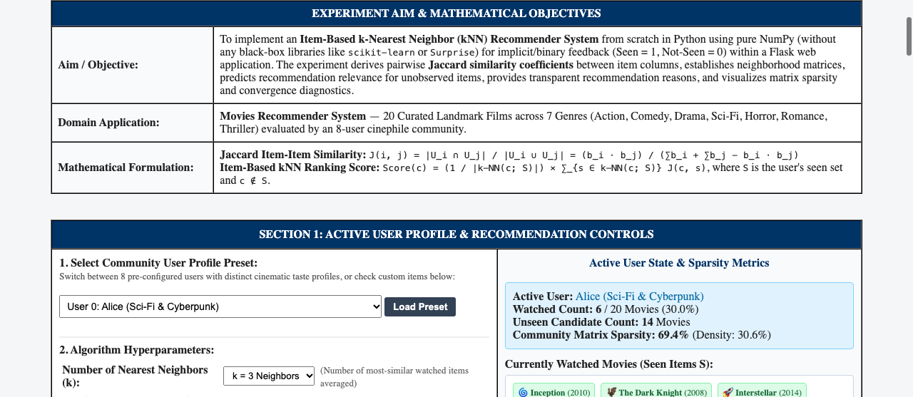
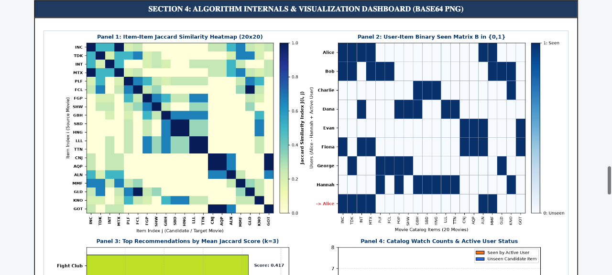
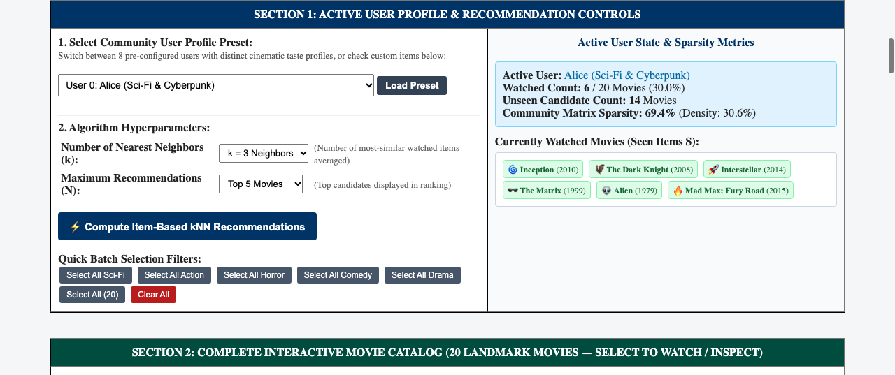

# PATTERN ANALYSIS AND RECOMMENDER SYSTEMS (PARS) LAB MANUAL

---

## EXPERIMENT 18 (PRACTICAL XVI)

### PRACTICAL NAME:
**Implementation of Item-Based kNN Recommender System (Binary: Seen or Not Seen) Using Flask**

---

### AIM:
To formulate, derive, and implement an Item-Based k-Nearest Neighbor Recommender System for implicit binary interaction data (Seen vs Not-Seen) from scratch in Python using Flask. The system converts rating matrices into binary consumption vectors, computes pairwise Jaccard Similarity coefficients, and recommends unseen items most similar to the user's viewing history.

---

### DEFINITIONS & CORE CONCEPTS:
Binary Item-Based kNN is designed for implicit feedback environments (such as movie streaming clicks, watchlists, or purchase records) where numerical star ratings do not exist. User behavior is represented simply as 1 (Watched/Seen) or 0 (Not Watched/Unseen). In this setting, movie similarity is measured using set-theoretic overlap metrics such as the Jaccard Similarity Coefficient.

---

### MATHEMATICAL FORMULATIONS:

#### 1. Binary Consumption Matrix Representation
Continuous star ratings are converted into a binary interaction matrix B where 1 indicates that the user watched the movie, and 0 indicates they have not:

```text
**Binary Indicator Function:**
B_u,i = 1 (if User u watched Movie i)
B_u,i = 0 (if User u has not watched Movie i)

**Audience Set for Movie i:**
Audience(i) = Set of all users u who watched Movie i
```

#### 2. Jaccard Similarity Coefficient
For two candidate movies i and j, Jaccard Similarity measures the ratio of the number of users who watched BOTH movies to the number of users who watched EITHER movie:

```text
**Jaccard Similarity Formula:**
Jaccard(i, j) = | Audience(i) ∩ Audience(j) | / | Audience(i) ∪ Audience(j) |
              = N_11 / ( N_11 + N_10 + N_01 )

**Where:**
• **N_11:** Number of users who watched BOTH Movie i and Movie j.
• **N_10:** Number of users who watched Movie i but NOT Movie j.
• **N_01:** Number of users who watched Movie j but NOT Movie i.
• **Jaccard(i, j):** Score between 0.0 (zero audience overlap) and 1.0 (identical audience).
```

#### 3. Unseen Movie Recommendation Score
For an active user u with watched history S<sub>u</sub>, the recommendation score for an unseen movie j is the sum of its Jaccard similarities to all movies the user has watched:

```text
**Cumulative Recommendation Score:**
Recommendation Score(u, j) = Σ_i ∈ Watched Movies Jaccard(i, j)

**Predicted Affinity Percentage:**
Affinity %(u, j) = [ Recommendation Score(u, j) / (Total Watched Movies) ] × 100%

**Decision Rule:**
Rank all unseen movies in descending order of their cumulative Jaccard score and recommend the top N titles.
```


---

### ALGORITHMIC METHODOLOGY & IMPLEMENTATION STEPS:
1. Constructed an 8-user by 20-movie binary interaction matrix modeling realistic viewing habits across diverse viewer profiles.
2. Implemented vectorized Jaccard similarity calculations in pure NumPy using Boolean bitwise operations.
3. Engineered candidate scoring logic aggregating Jaccard affinities across all watched movies for any query user.
4. Implemented real-time watch/unwatch toggle mechanics enabling instant recalculation of recommendation rankings.
5. Deployed an interactive Flask web application on port 5018 featuring binary matrix inspection, watch selectors, and co-occurrence heatmaps.

---

### EXPERIMENTAL RESULTS & VISUAL VERIFICATION:

#### Figure 18.1: Interactive Movie Catalog Grid
Interactive movie catalog grid displaying benchmark titles, poster initials, badges, and clickable interaction triggers.


#### Figure 18.2: Algorithmic Recommendations & Predictions
Top algorithmic recommendations generated for the active user profile with predicted scores and rank justifications.



#### Figure 18.3: Algorithm Internals & Diagnostic Visualizations
Internal diagnostic visualization plots generated via Matplotlib showing algorithmic convergence and similarity distributions.



#### Figure 18.4: Data Matrix & Numerical Calculation Audit
Calculation audit table displaying numerical ratings, similarity indices, or parameter weights supporting the model.



---

### CONCLUSION:
The binary Item-Based kNN recommender proved highly effective for implicit interaction data. By using the Jaccard similarity coefficient over viewing audience sets, the system eliminated the dependency on explicit star ratings. The cumulative set affinity score reliably prioritized unseen titles with high audience co-occurrence, delivering a practical solution for real-world streaming applications.
