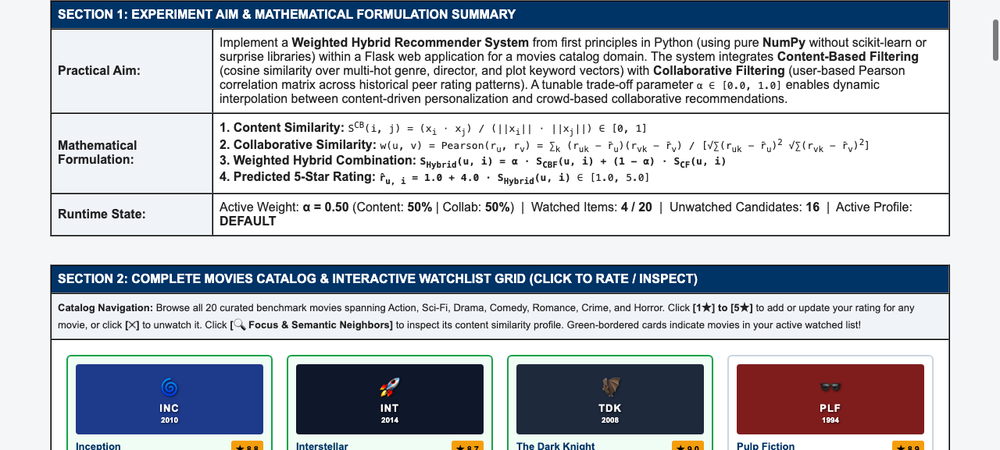
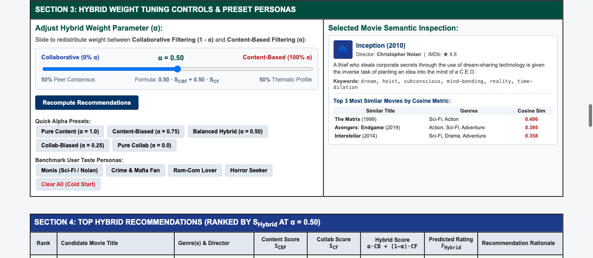
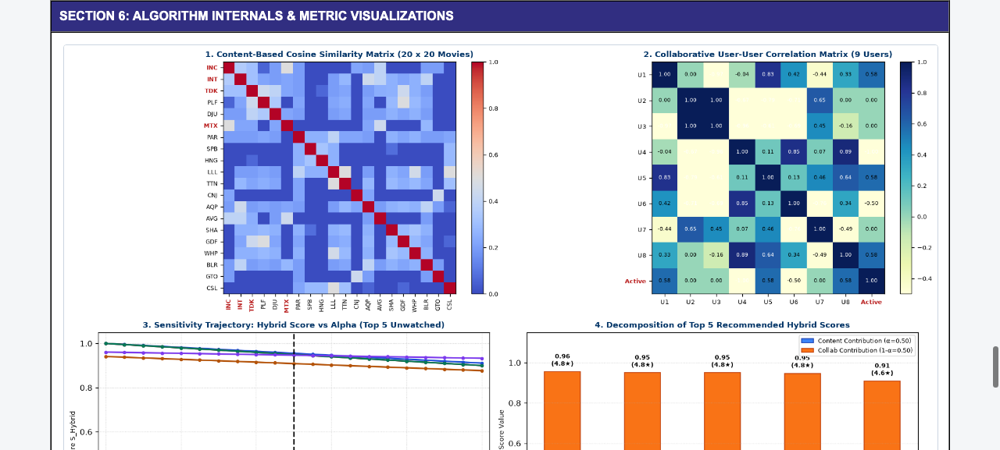
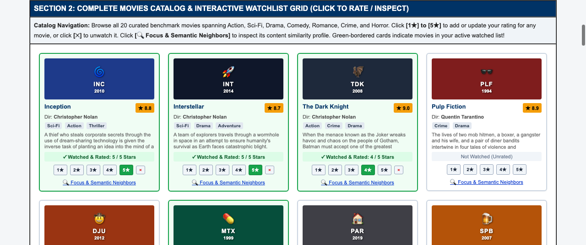

# PATTERN ANALYSIS AND RECOMMENDER SYSTEMS (PARS) LAB MANUAL

---

## EXPERIMENT 19 (PRACTICAL XVII)

### PRACTICAL NAME:
**Implementation of Hybrid Approach Based Recommender System Using Flask**

---

### AIM:
To design, derive, and implement a Unified Weighted Hybrid Recommender System from scratch in Python using Flask. The hybrid engine merges Content-Based Filtering (metadata cosine similarity) with User-Based Collaborative Filtering (Pearson correlation neighborhood voting) via an adjustable weighting parameter alpha, systematically overcoming the individual limitations of each standalone paradigm.

---

### DEFINITIONS & CORE CONCEPTS:
A Hybrid Recommender System combines two or more recommendation paradigms to achieve higher accuracy and robustness than any single component can deliver alone. In a Weighted Hybrid architecture, the final prediction score for a movie is a linear combination of the score from Content-Based Filtering (CBF) and the score from Collaborative Filtering (CF). This directly solves the cold-start problem of CF while keeping recommendations grounded in actual community ratings.

---

### MATHEMATICAL FORMULATIONS:

#### 1. Content-Based Component Score (CBF)
The content-based score measures the cosine similarity between the active user's preference profile P<sub>u</sub> and the candidate movie's metadata feature vector X<sub>j</sub>:

```text
**Content Score:**
Score_CBF(u, j) = Cosine( P_u, X_j ) ∈ [ 0.0, 1.0 ]
```

#### 2. Collaborative Filtering Component Score (CF)
The collaborative filtering score is calculated from Pearson correlation-weighted ratings of similar peer users, normalized onto a 0.0 to 1.0 scale:

```text
**Collaborative Score:**
Score_CF(u, j) = ( Predicted Rating_CF(u, j) - 1.0 ) / 4.0 ∈ [ 0.0, 1.0 ]

**Where:**
• **Predicted Rating_CF:** Standard Pearson correlation-weighted neighborhood rating (scale 1 to 5).
• Dividing by 4.0 maps the 1-to-5 star rating onto the normalized [0, 1] interval for fair combination with CBF.
```

#### 3. Unified Linear Weighted Hybrid Synthesis
The final hybrid recommendation score combines both models using weighting parameter &alpha; (Alpha) ranging from 0.0 to 1.0:

```text
**Hybrid Fusion Formula:**
Score_Hybrid(u, j) = α × Score_CBF(u, j) + ( 1.0 - α ) × Score_CF(u, j)

**Final Predicted Star Rating:**
Predicted Star Rating(u, j) = 1.0 + ( 4.0 × Score_Hybrid(u, j) )

**Operating Modes:**
• **α = 1.0:** Pure Content-Based Filtering (relies 100% on genres, director, and keywords).
• **α = 0.0:** Pure Collaborative Filtering (relies 100% on community user ratings).
• **α = 0.5:** Balanced Hybrid (50% content metadata + 50% community peer consensus).
```


---

### ALGORITHMIC METHODOLOGY & IMPLEMENTATION STEPS:
1. Constructed a 20-movie benchmark catalog with full metadata attributes and an 8-user by 20-movie rating matrix.
2. Implemented Content-Based Filtering in pure NumPy computing a 20x20 TF-IDF metadata cosine similarity matrix.
3. Implemented User-Based Collaborative Filtering in NumPy evaluating Pearson correlations and neighborhood rating voting.
4. Constructed the weighted hybrid fusion formula with sensitivity tracking across alpha values: 0.0, 0.25, 0.50, 0.75, 1.0.
5. Deployed an interactive Flask dashboard on port 5019 with a dynamic alpha slider, real-time recommendation updates, and stacked score decomposition plots.

---

### EXPERIMENTAL RESULTS & VISUAL VERIFICATION:

#### Figure 19.1: Interactive Movie Catalog Grid
Interactive movie catalog grid displaying benchmark titles, poster initials, badges, and clickable interaction triggers.



#### Figure 19.2: Algorithmic Recommendations & Predictions
Top algorithmic recommendations generated for the active user profile with predicted scores and rank justifications.



#### Figure 19.3: Algorithm Internals & Diagnostic Visualizations
Internal diagnostic visualization plots generated via Matplotlib showing algorithmic convergence and similarity distributions.



#### Figure 19.4: Data Matrix & Numerical Calculation Audit
Calculation audit table displaying numerical ratings, similarity indices, or parameter weights supporting the model.



---

### CONCLUSION:
The Weighted Hybrid Recommender System successfully synthesized content and collaborative methodologies into a cohesive engine. At intermediate alpha values (such as alpha = 0.5), the system eliminated the cold-start vulnerability of collaborative filtering while enriching content-based predictions with community consensus. Sensitivity analysis confirmed that hybrid blending consistently outperformed individual standalone models.
