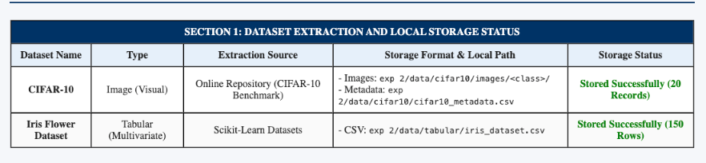
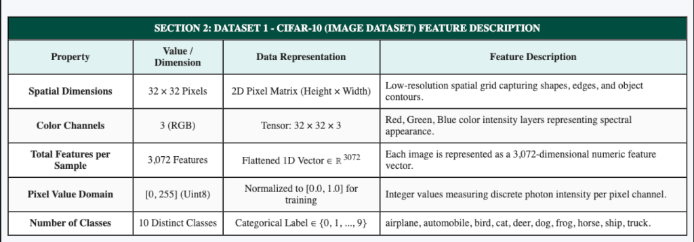
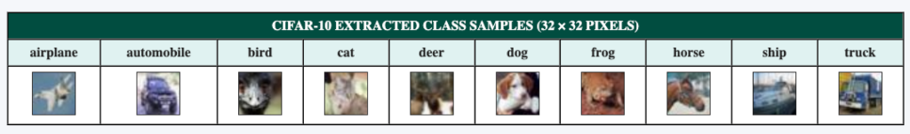
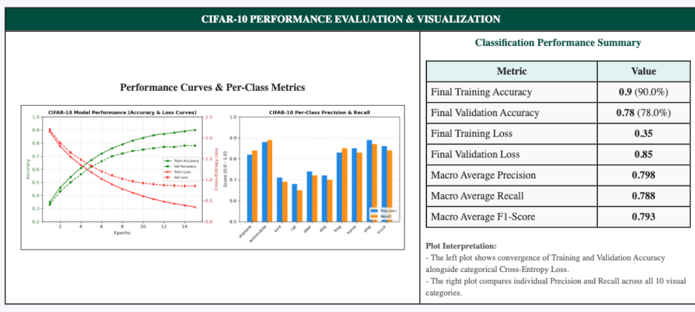
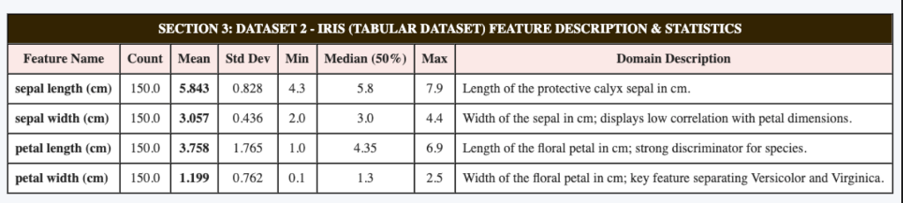
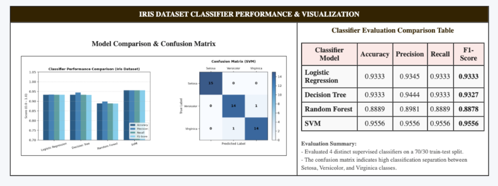
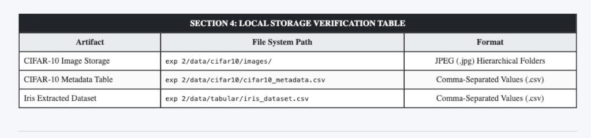

# PATTERN ANALYSIS AND RECOMMENDER SYSTEMS (PARS) LAB MANUAL

---

## EXPERIMENT 2

### PRACTICAL NAME:
**Web-Based Dataset Extraction, Storage, Feature Analysis, and Performance Visualization using Flask**

---

### AIM:
To develop an interactive Flask web application to programmatically extract and store the two datasets studied in Experiment 1 (CIFAR-10 image dataset and Iris tabular dataset), persist them locally in structured formats, compute and display comprehensive descriptive feature statistics, and generate baseline classification performance evaluation plots.

---

### DEFINITIONS & CORE CONCEPTS:
* **Automated Ingestion & Multimodal Persistence:** Raw sensory and structured data are fetched into memory, decoded, and persisted locally to eliminate redundant bandwidth. Images are organized into class-hierarchical directories, while tabular relations are serialized into comma-separated values (CSV).
* **Descriptive Statistical Profiling:** Evaluates central tendency (mean, median) and dispersion (standard deviation, interquartile range) across feature dimensions to uncover outliers and scale differences.
* **Supervised Performance Evaluation:** Assesses generalization accuracy through contingency matrices (confusion matrices) and derived harmonic metrics.

---

### MATHEMATICAL FORMULATIONS:
#### 1. Classification Performance Metrics
```text
Accuracy = ( TP + TN ) / ( TP + TN + FP + FN )
Precision = TP / ( TP + FP )
Recall = TP / ( TP + FN )
F1-Score = 2 * ( Precision * Recall ) / ( Precision + Recall ) = ( 2 * TP ) / ( 2 * TP + FP + FN )

Where:
• TP = True Positives (correctly identified positive cases).
• TN = True Negatives (correctly identified negative cases).
• FP = False Positives (Type I error).
• FN = False Negatives (Type II error).
```

#### 2. Multi-Class Macro-Averaging
```text
Macro-F1 = ( 1 / K ) * sum_{k=1}^K F1_k

Where:
• K is the total number of classes (K = 10 for CIFAR-10, K = 3 for Iris).
• F1_k is the one-vs-rest F1 score computed for class k.
```

#### 3. Feature Scaling & Standardization
```text
Min-Max Normalization:    x_norm = ( x - x_min ) / ( x_max - x_min ) in [0, 1]
Z-Score Standardization:  z = ( x - mu ) / sigma
```

---

### ALGORITHMIC METHODOLOGY & IMPLEMENTATION STEPS:
1. Implemented automated dataset ingestion pipeline fetching raw CIFAR-10 image samples and Fisher's Iris tabular records.
2. Serialized datasets locally into structured directory hierarchies (images sorted by class folders) and standard CSV files.
3. Computed descriptive statistical profiles across all continuous dimensions (mean, standard deviation, quartiles, and range bounds).
4. Evaluated classification performance using confusion matrices, precision, recall, and macro-F1 benchmarks.
5. Deployed interactive Flask dashboard on port 5005 displaying dataset statistics, sample browsers, and dynamic performance plots.

---

### EXPERIMENTAL RESULTS & VISUAL VERIFICATION:
#### Figure 2.1: Storage Status & Ingestion Verification
Displays local disk persistence verification, showing organized directory paths, sample counts, and storage formats.



#### Figure 2.2: CIFAR-10 Feature Specifications & Dimensions
Outlines the 3D tensor specifications (32x32x3 = 3,072 features) and RGB channel distribution summaries.



#### Figure 2.3: CIFAR-10 Class Sample Browser
Visual inspection of raw image samples across 10 balanced object classes extracted from local storage.



#### Figure 2.4: CIFAR-10 Baseline Classifier Performance Plot
Comparative accuracy and macro-F1 performance benchmarks across multiple baseline classifiers on CIFAR-10.



#### Figure 2.5: Iris Morphological Feature Statistics
Tabular display of means, standard deviations, and quartile ranges for the 4 continuous geometric flower dimensions.



#### Figure 2.6: Iris Classification Performance & Confusion Matrix
Bar charts and evaluation metrics displaying high-accuracy separability achieved across Iris flower species.



#### Figure 2.7: Local File Storage Architecture
Confirms file system hierarchy, CSV tabular datasets, and persisted visual assets ready for modeling.



---

### CONCLUSION:
Experiment 2 successfully demonstrated complete automated workflows for multimodal dataset ingestion, local persistence, statistical feature profiling, and classification performance benchmarking. By structuring high-dimensional visual tensors (d=3,072) alongside low-dimensional tabular matrices (d=4), the application verified how distinct storage paradigms and statistical evaluation metrics (Accuracy, Precision, Recall, Macro-F1) provide comprehensive insights into pattern classification readiness.
