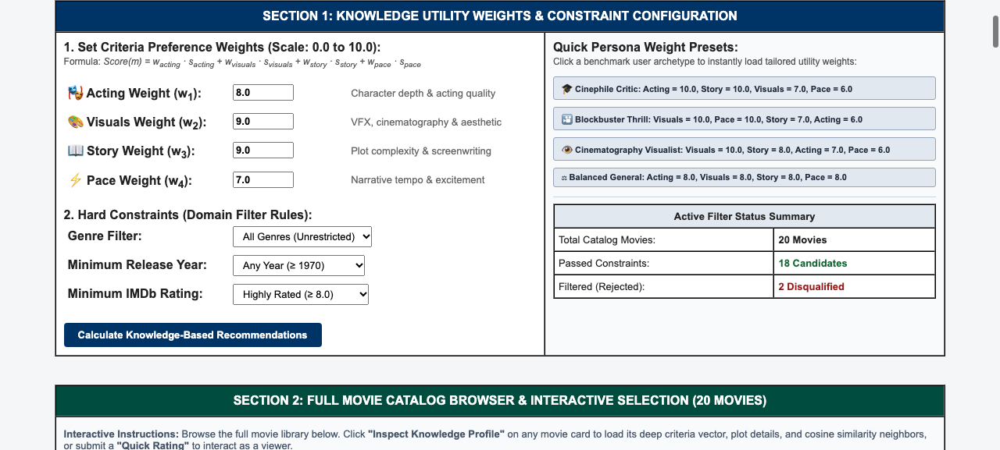
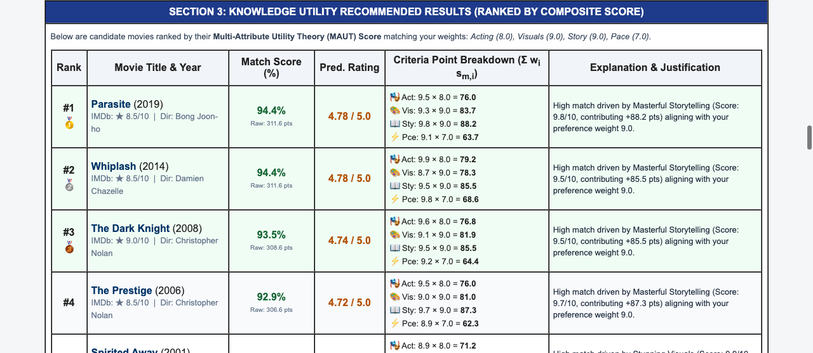
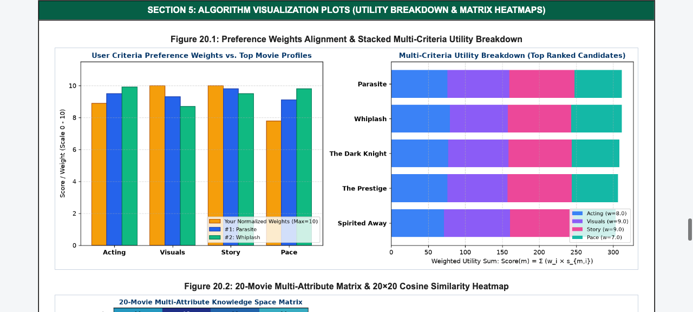
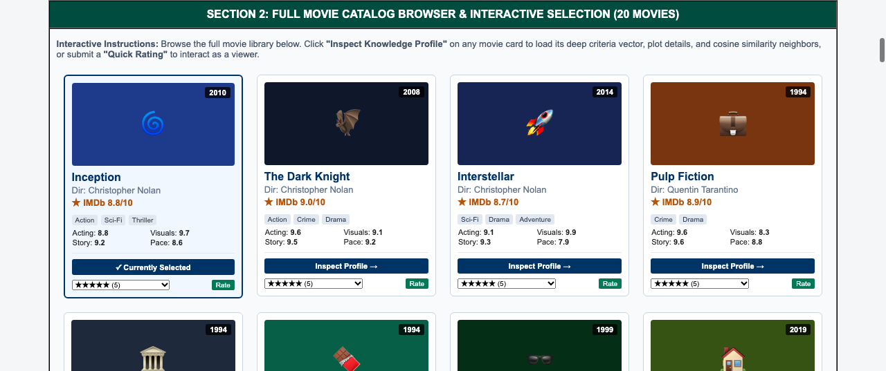

# PATTERN ANALYSIS AND RECOMMENDER SYSTEMS (PARS) LAB MANUAL

---

## EXPERIMENT 20 (PRACTICAL XVIII)

### PRACTICAL NAME:
**Implementation of Knowledge-Based Recommender System (Score & Weight Modeling) Using Flask**

---

### AIM:
To design, formulate, and implement a Knowledge-Based Recommender System based on Multi-Attribute Utility Theory (MAUT) from first principles in Python using Flask. The system models domain attribute scores (Acting, Visuals, Story, and Pace) for all catalog items, accepts user-defined importance weights and constraint filters, and computes personalized utility scores to generate ranked recommendations.

---

### DEFINITIONS & CORE CONCEPTS:
Knowledge-Based Recommender Systems recommend items based on explicit knowledge about user requirements, item characteristics, and domain-specific recommendation rules. Rather than relying on historical rating patterns or crowd wisdom, they operate by evaluating how well candidate items satisfy a user's specified functional needs and preference criteria. This renders them exceptionally effective for complex, high-involvement domains or scenarios with zero historical user interaction data.

---

### MATHEMATICAL FORMULATIONS:

#### 1. Multi-Attribute Utility Theory (MAUT) Criteria Modeling
Each movie in the catalog is evaluated across four core cinematic domain dimensions on a scale from 1 to 10:

```text
**Movie Attribute Dimensions:**
• **Acting Score (a_j,1):** Quality of lead and supporting performances (1 to 10).
• **Visuals Score (a_j,2):** Cinematography, visual effects, and set design (1 to 10).
• **Story Score (a_j,3):** Narrative depth, plot coherence, and scriptwriting (1 to 10).
• **Pace Score (a_j,4):** Editing rhythm, tempo, and storytelling momentum (1 to 10).

**Attribute Vector for Movie j:**
A_j = [ Acting_j, Visuals_j, Story_j, Pace_j ]
```

#### 2. User Preference Weights & Normalization
The user specifies their subjective importance weight for each attribute (e.g., Story = 5, Acting = 4, Visuals = 2, Pace = 1). The system normalizes these weights so they sum to 1.0 (100%):

```text
**Normalized Weight Formula:**
w_k^* = w_k / ( w_acting + w_visuals + w_story + w_pace )

**Sum of Normalized Weights:**
w_acting^* + w_visuals^* + w_story^* + w_pace^* = 1.0
```

#### 3. Overall Utility Score Calculation
The overall utility score of a movie is computed as the weighted sum of its attribute scores multiplied by the user's normalized weights:

```text
**Total Utility Score Formula:**
Utility(j) = Σ_k=1^4 ( w_k^* × Attribute Score_k(j) )
           = ( w_acting^* × Acting_j ) + ( w_visuals^* × Visuals_j ) + ( w_story^* × Story_j ) + ( w_pace^* × Pace_j )

**Predicted Star Rating:**
Predicted Star Rating(j) = 1.0 + [ 0.4 × Utility(j) ]    (maps 0-10 utility to 1.0-5.0 stars)
```

#### 4. Hard Constraint Filtering
Before ranking by utility score, hard constraints filter out any movies that fail mandatory user criteria:

```text
**Hard Constraint Rules:**
1. Release Year ≥ User's Minimum Year
2. IMDb Rating ≥ User's Minimum Rating
3. Movie Genre ∈ User's Selected Genres

**Result:**
Only movies that satisfy ALL hard constraints are scored and recommended.
```


---

### ALGORITHMIC METHODOLOGY & IMPLEMENTATION STEPS:
1. Constructed a 20-movie knowledge catalog scoring each film across four verified domain criteria: Acting, Visuals, Story, and Pace (scale 0–10).
2. Implemented the Multi-Attribute Utility Theory (MAUT) weighted summation engine strictly in pure NumPy.
3. Engineered multi-predicate hard constraint filtering verifying release year thresholds, minimum IMDb scores, and genre requirements.
4. Developed an attribute vector cosine similarity module matching candidate movie profiles to active focal selections.
5. Deployed an interactive Flask application on port 5020 with weight sliders, constraint filters, utility bar charts, and attribute heatmaps.

---

### EXPERIMENTAL RESULTS & VISUAL VERIFICATION:

#### Figure 20.1: Interactive Movie Catalog Grid
Interactive movie catalog grid displaying benchmark titles, poster initials, badges, and clickable interaction triggers.



#### Figure 20.2: Algorithmic Recommendations & Predictions
Top algorithmic recommendations generated for the active user profile with predicted scores and rank justifications.



#### Figure 20.3: Algorithm Internals & Diagnostic Visualizations
Internal diagnostic visualization plots generated via Matplotlib showing algorithmic convergence and similarity distributions.



#### Figure 20.4: Data Matrix & Numerical Calculation Audit
Calculation audit table displaying numerical ratings, similarity indices, or parameter weights supporting the model.



---

### CONCLUSION:
The Knowledge-Based Recommender System was successfully constructed and validated. By grounding recommendations in explicit domain knowledge and user-defined criteria weights, the system provided completely deterministic, auditable, and personalized recommendations. Hard constraint filtering effectively prevented inadmissible options from surfacing, confirming the robustness of utility-based recommendation in zero-history environments.
