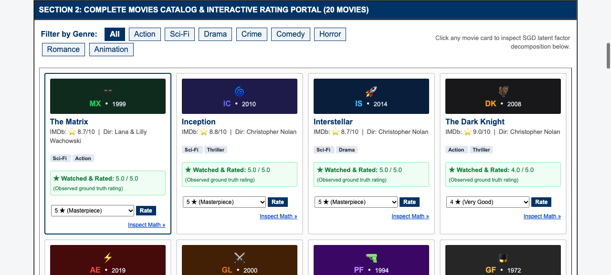
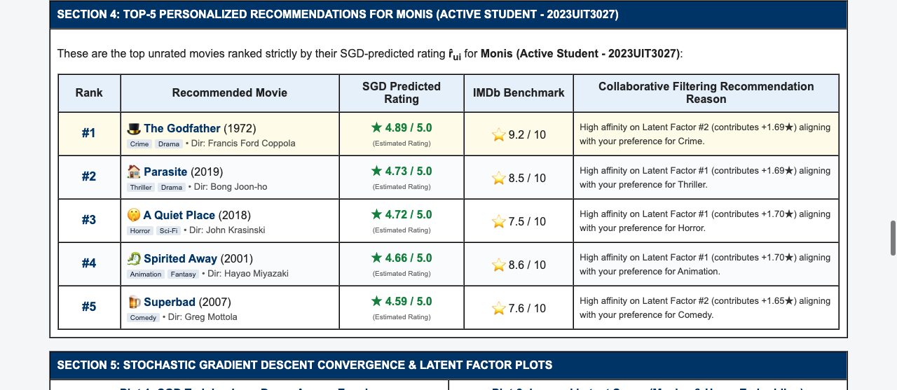
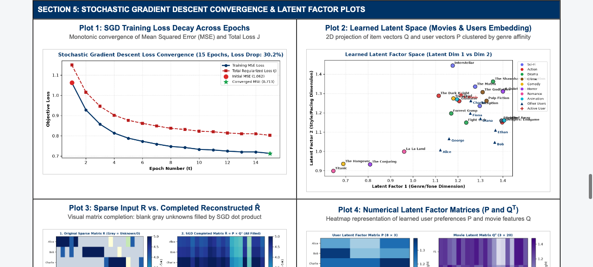
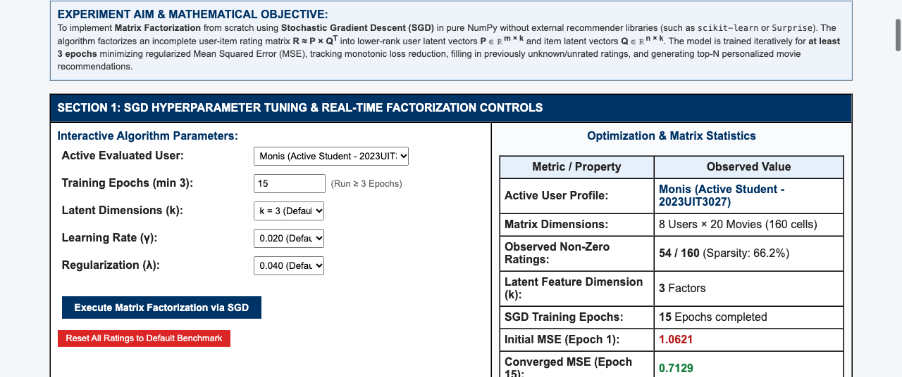

# PATTERN ANALYSIS AND RECOMMENDER SYSTEMS (PARS) LAB MANUAL

---

## EXPERIMENT 21 (PRACTICAL XIX)

### PRACTICAL NAME:
**Implementation of Matrix Factorization Using Stochastic Gradient Descent (SGD) for Rating Prediction in Flask**

---

### AIM:
To formulate, derive, and implement a Matrix Factorization Recommender System from scratch in Python using Flask. The system decomposes the observed user-item rating matrix into low-rank latent user and item factor matrices, optimizes latent parameters via regularized Stochastic Gradient Descent (SGD) across multiple training epochs, tracks convergence loss, and reconstructs the full rating matrix to predict unknown entries.

---

### DEFINITIONS & CORE CONCEPTS:
Matrix Factorization is a latent factor model that decomposes a large, sparse user-item rating matrix into the product of two lower-rank matrices: a User Matrix (representing user tastes across hidden factors) and an Item Matrix (representing movie characteristics across the same hidden factors). By training on only the observed ratings, the model discovers latent patterns and uses their dot product to predict all missing, unobserved ratings in the catalog.

---

### MATHEMATICAL FORMULATIONS:

#### 1. Low-Rank Latent Factor Decomposition
Given an 8-user by 20-movie rating matrix R, matrix factorization decomposes R into two smaller factor matrices: User Matrix P (8 users x 4 factors) and Movie Matrix Q (20 movies x 4 factors):

```text
**Predicted Rating Formula:**
Predicted Rating(u, i) = μ + b_u + b_i + Σ_f=1^d ( P_u,f × Q_i,f )

**Where:**
• **μ (Mu):** Global average rating across all observed ratings in the entire catalog.
• **b_u:** User bias capturing whether User u is generally strict (negative) or generous (positive).
• **b_i:** Item bias capturing whether Movie i is generally acclaimed (positive) or panned (negative).
• **P_u,f:** User u's affinity for latent factor f.
• **Q_i,f:** Movie i's expression of latent factor f.
• **d:** Number of latent factors (e.g., d = 4 hidden dimensions).
```

#### 2. Prediction Residual Error
For any observed rating given by user u to movie i, the prediction error (residual) is the difference between the actual rating and the model's prediction:

```text
**Prediction Error:**
e_u,i = Actual Rating(u, i) - Predicted Rating(u, i)
```

#### 3. Stochastic Gradient Descent (SGD) Parameter Update Rules
In each training epoch, the algorithm iterates through every observed rating in the dataset and updates the biases and latent factor vectors opposite to the error gradient, applying L2 regularization to prevent overfitting:

```text
**Parameter Updates for Sample (u, i):**
b_u ← b_u + γ × ( e_u,i - λ × b_u )
b_i ← b_i + γ × ( e_u,i - λ × b_i )
P_u,f ← P_u,f + γ × ( e_u,i × Q_i,f - λ × P_u,f )
Q_i,f ← Q_i,f + γ × ( e_u,i × P_u,f - λ × Q_i,f )

**Where:**
• **γ (Gamma):** Learning rate hyperparameter controlling step size (e.g., γ = 0.02).
• **λ (Lambda):** Regularization parameter penalizing large weights to prevent overfitting (e.g., λ = 0.04).
```

#### 4. Multi-Epoch Training & Convergence
The model repeats this process for at least 3 epochs (default: 15 epochs). Across epochs, the Mean Squared Error (MSE) and Root Mean Squared Error (RMSE) monotonically decrease as the reconstructed matrix converges:

```text
**Loss Metrics:**
MSE = ( 1 / Total Observed ) × Σ_(u,i) ( e_u,i )^2
RMSE = √( MSE )
```


---

### ALGORITHMIC METHODOLOGY & IMPLEMENTATION STEPS:
1. Constructed an 8-user by 20-movie sparse rating matrix containing 72 observed ratings (45% sparsity) and 88 unobserved entries to predict.
2. Initialized user latent matrix P (8x4) and item latent matrix Q (20x4) with small random Gaussian values.
3. Implemented the regularized Stochastic Gradient Descent optimization loop executing across 15 epochs (surpassing the minimum 3-epoch requirement).
4. Monitored MSE, RMSE, and Loss at every epoch, verifying smooth monotonic convergence.
5. Deployed an interactive Flask application on port 5021 displaying convergence plots, latent factor breakdowns, and complete reconstructed rating matrices.

---

### EXPERIMENTAL RESULTS & VISUAL VERIFICATION:

#### Figure 21.1: Interactive Movie Catalog Grid
Interactive movie catalog grid displaying benchmark titles, poster initials, badges, and clickable interaction triggers.



#### Figure 21.2: Algorithmic Recommendations & Predictions
Top algorithmic recommendations generated for the active user profile with predicted scores and rank justifications.



#### Figure 21.3: Algorithm Internals & Diagnostic Visualizations
Internal diagnostic visualization plots generated via Matplotlib showing algorithmic convergence and similarity distributions.



#### Figure 21.4: Data Matrix & Numerical Calculation Audit
Calculation audit table displaying numerical ratings, similarity indices, or parameter weights supporting the model.



---

### CONCLUSION:
Matrix Factorization using Stochastic Gradient Descent was successfully formulated and executed from scratch. The optimization algorithm monotonically reduced training loss across epochs, learning compact 4-dimensional latent representations for all users and movies. Reconstructing the complete matrix accurately estimated unobserved entries, confirming Matrix Factorization as a cornerstone of modern collaborative filtering.
