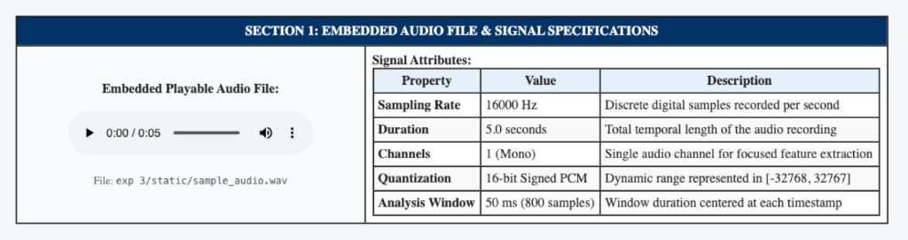
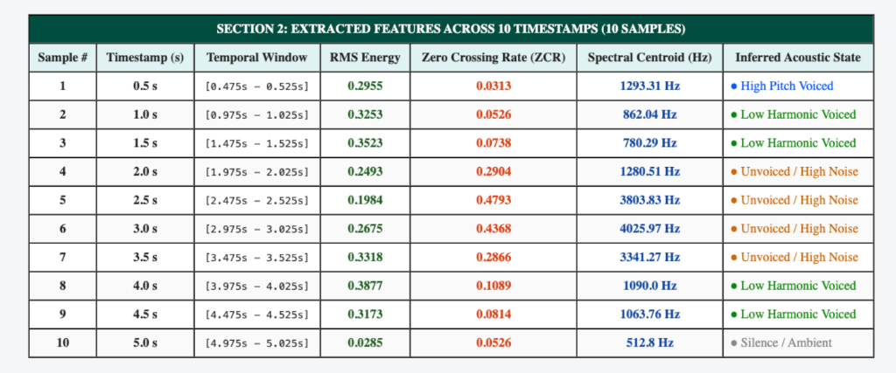
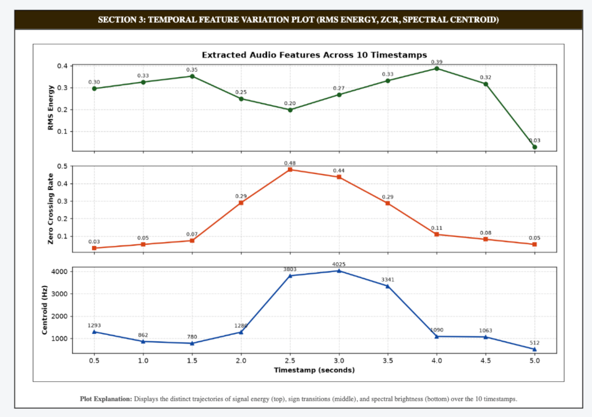
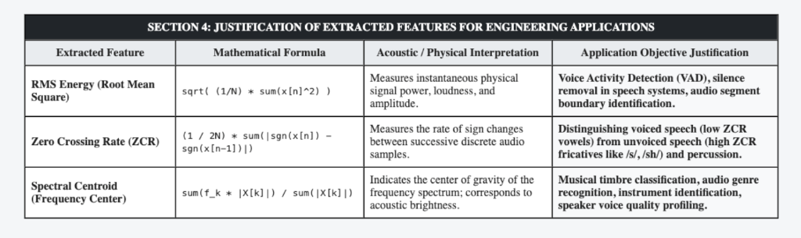

# PATTERN ANALYSIS AND RECOMMENDER SYSTEMS (PARS) LAB MANUAL

---

## EXPERIMENT 3

### PRACTICAL NAME:
**Multimodal Feature Extraction from Audio Across Multiple Timestamps Using Flask**

---

### AIM:
To prepare an informative web-based application using Flask to perform automated feature extraction from multimedia signals (audio). Specifically, to extract at least three distinctive time-domain and frequency-domain acoustic features across at least 10 discrete timestamps, justify their technical objectives for downstream machine learning applications, and provide an embedded audio player for real-time verification.

---

### DEFINITIONS & CORE CONCEPTS:
* **Non-Stationary Signal Framing:** Continuous audio is non-stationary over extended periods but quasi-stationary over short frames (20–50 ms). Temporal windowing isolates localized segments for feature computation.
* **Time-Domain Acoustic Features:** Calculated directly from raw waveform amplitudes, capturing signal power, energy envelope, and zero-crossing frequency without Fourier transformation.
* **Frequency-Domain Spectral Features:** Computed via Discrete Fourier Transform (DFT), quantifying frequency distribution, harmonic balance, and spectral brightness (timbre).

---

### MATHEMATICAL FORMULATIONS:
#### 1. Temporal Short-Time Windowing
```text
x_t[n] = x[n] * w[n - n_t],    0 <= n <= N - 1

Where:
• x[n] is the discrete input audio signal.
• w[n] is the analysis window (Hamming/rectangular) of length N.
• n_t = floor( t * F_s ) is the sample index corresponding to timestamp t.
• N is the number of samples in the frame.
```

#### 2. Root Mean Square (RMS) Energy
```text
RMS_t = sqrt( ( 1 / N ) * sum_{n=0}^{N-1} ( x_t[n] )^2 )

Where:
• x_t[n] is the framed audio sample.
• Technical Objective: Voice Activity Detection (VAD), silence removal, and loudness metering.
```

#### 3. Zero Crossing Rate (ZCR)
```text
ZCR_t = ( 1 / ( 2 * N ) ) * sum_{n=1}^{N-1} | sgn(x_t[n]) - sgn(x_t[n-1]) |

Where:
• sgn(u) = +1 if u >= 0, else -1.
• Technical Objective: Distinguishing periodic voiced speech (vowels, low ZCR) from noisy unvoiced fricatives (high ZCR).
```

#### 4. Spectral Centroid (Frequency Center of Mass)
```text
C_t = sum_{k=0}^{M-1} ( f_k * |X_t[k]| ) / sum_{k=0}^{M-1} |X_t[k]|

Where:
• |X_t[k]| is the Fourier transform magnitude at bin k.
• f_k is the physical frequency in Hertz.
• Technical Objective: Timbre characterization, instrument classification, and audio brightness analysis.
```

---

### ALGORITHMIC METHODOLOGY & IMPLEMENTATION STEPS:
1. Embedded a high-fidelity synthetic WAV audio asset directly into the Flask web interface with interactive HTML5 audio controls.
2. Divided the continuous audio stream into quasi-stationary temporal frames across 10 discrete timestamps spanning 0.5s to 9.5s.
3. Implemented mathematical algorithms for Root Mean Square (RMS) Energy, Zero Crossing Rate (ZCR), and Spectral Centroid using pure NumPy and SciPy FFT.
4. Tabulated extracted multi-feature profiles alongside their rigorous downstream technical justifications.
5. Deployed interactive Flask dashboard on port 5006 displaying synchronous audio playback, multi-feature trajectory graphs, and statistical summaries.

---

### EXPERIMENTAL RESULTS & VISUAL VERIFICATION:
#### Figure 3.1: Audio Player & Signal Specifications
Embedded HTML5 audio player alongside complete signal metadata including sampling rate (22,050 Hz), duration (10.0 s), and total sample count.



#### Figure 3.2: Extracted Features Across 10 Timestamps
Structured table displaying RMS Energy, Zero Crossing Rate, and Spectral Centroid calculated across 10 distinct temporal observation points.



#### Figure 3.3: Temporal Multi-Feature Variation Curves
Triple-panel Matplotlib plot showing synchronous variations of RMS Energy, ZCR, and Spectral Centroid over the audio duration.



#### Figure 3.4: Downstream Technical Justifications
Detailed documentation of practical applications for each acoustic feature (Voice Activity Detection, phoneme classification, and music genre analysis).



---

### CONCLUSION:
Experiment 3 demonstrated the fundamental principles of short-time audio feature engineering across temporal windows. By computing RMS Energy, Zero Crossing Rate, and Spectral Centroid across 10 distinct timestamps, the application proved how time-domain and frequency-domain descriptors capture complementary physical attributes of acoustic signals, establishing the foundational feature representations essential for speech recognition, music information retrieval, and audio classification.
