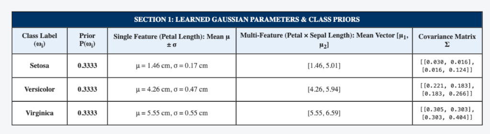
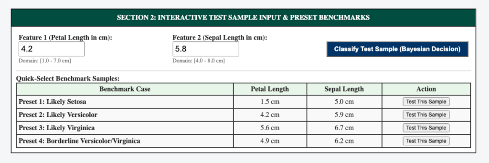
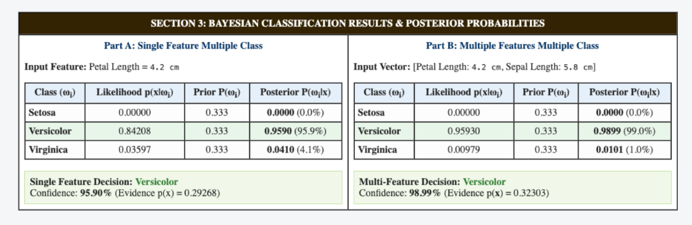
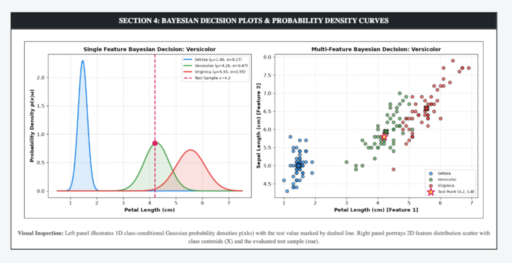

# PATTERN ANALYSIS AND RECOMMENDER SYSTEMS (PARS) LAB MANUAL

---

## EXPERIMENT 4

### PRACTICAL NAME:
**Bayesian Classification for Single Feature & Multiple Features Multiple Class Using Flask**

---

### AIM:
To design, formulate, and deploy an interactive Flask web application to perform pattern classification using the Bayesian framework for both 1) Single Feature Multi-Class models and 2) Multiple Features Multi-Class models. The system fits Gaussian class-conditional likelihoods, calculates posterior class probabilities, and classifies arbitrary user-supplied test samples according to the Maximum A Posteriori (MAP) decision rule.

---

### DEFINITIONS & CORE CONCEPTS:
* **Bayesian Pattern Classification:** A statistical decision-theoretic framework that minimizes classification error by combining prior probabilities with feature likelihoods.
* **Class-Conditional Likelihood:** The probability density of observing feature x given true class omega_k, modeled via univariate or multivariate Normal distributions.
* **Maximum A Posteriori (MAP) Rule:** Assigns candidate sample x to the class maximizing posterior probability P(omega_k | x).

---

### MATHEMATICAL FORMULATIONS:
#### 1. Bayes' Theorem for Pattern Classification
```text
P(omega_k | x) = [ p(x | omega_k) * P(omega_k) ] / p(x)
where p(x) = sum_{j=1}^K [ p(x | omega_j) * P(omega_j) ]

Where:
• P(omega_k | x) is the posterior probability of class omega_k given sample x.
• p(x | omega_k) is the class-conditional probability density function (likelihood).
• P(omega_k) is the prior probability of class omega_k.
• p(x) is the evidence normalization factor.
```

#### 2. Univariate Gaussian Likelihood (Single Feature)
```text
p(x | omega_k) = ( 1 / sqrt( 2 * pi * sigma_k^2 ) ) * exp( - ( x - mu_k )^2 / ( 2 * sigma_k^2 ) )

Where:
• mu_k is the class mean and sigma_k^2 is the class variance.
```

#### 3. Multivariate Gaussian Likelihood (Multiple Features)
```text
p(x | omega_k) = ( 1 / [ (2*pi)^(d/2) * |Sigma_k|^(1/2) ] ) * exp( - 0.5 * (x - mu_k)^T * Sigma_k^(-1) * (x - mu_k) )

Where:
• mu_k in R^d is the class centroid vector.
• Sigma_k in R^{d x d} is the class covariance matrix.
• |Sigma_k| is the covariance determinant.
• (x - mu_k)^T Sigma_k^(-1) (x - mu_k) is the squared Mahalanobis distance.
```

#### 4. MAP Decision Rule
```text
omega^* = argmax_k [ ln p(x | omega_k) + ln P(omega_k) ]
```

---

### ALGORITHMIC METHODOLOGY & IMPLEMENTATION STEPS:
1. Constructed training dataset from Fisher's Iris data spanning 3 distinct flower classes.
2. Estimated maximum likelihood Gaussian parameters: class scalar means and variances for Single Feature (Petal Length), and mean vectors and covariance matrices for Multiple Features (Sepal Length, Sepal Width, Petal Length, Petal Width).
3. Formulated univariate and multivariate Gaussian likelihood evaluators with numerical stability safeguards.
4. Built interactive Flask application on port 5007 accepting test sample inputs, computing real-time posterior probabilities, and rendering decision curves.

---

### EXPERIMENTAL RESULTS & VISUAL VERIFICATION:
#### Figure 4.1: Learned Statistical Class Parameters
Displays empirical class priors, univariate Gaussian means/variances, and full 4x4 multivariate covariance matrices across classes.



#### Figure 4.2: Interactive Sample Input Interface
Slider and numeric entry controls allowing users to supply arbitrary continuous test features for real-time classification.



#### Figure 4.3: Real-Time Posterior Probabilities & MAP Output
Shows resulting likelihoods, normalized posterior probabilities summing to 1.0, and final predicted class label.



#### Figure 4.4: Univariate Gaussian Curves & 2D Decision Boundaries
Visualization of bell-shaped probability density curves showing class overlap and 2D bivariate Gaussian contour decision boundaries.



---

### CONCLUSION:
Experiment 4 verified the theoretical rigor and practical efficacy of Bayesian pattern classification. By evaluating both Single Feature (univariate Gaussian) and Multiple Feature (multivariate Gaussian with full covariance matrices) models, the application demonstrated how Mahalanobis distance and class covariance geometry govern optimal decision surfaces under the Maximum A Posteriori (MAP) rule, achieving optimal error minimization.
