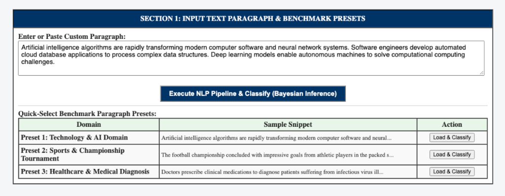
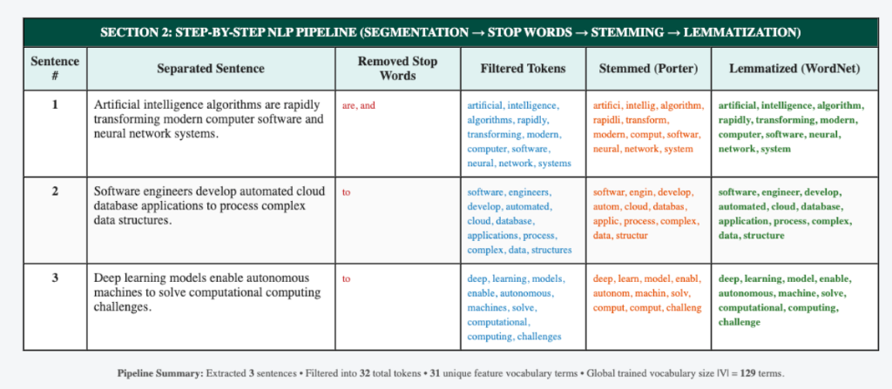
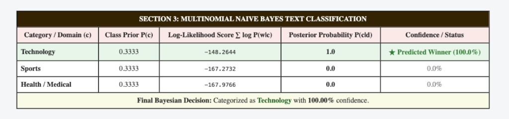
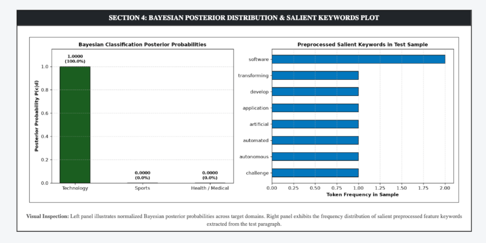

# PATTERN ANALYSIS AND RECOMMENDER SYSTEMS (PARS) LAB MANUAL

---

## EXPERIMENT 5

### PRACTICAL NAME:
**Text Paragraph Segmentation, Stop Words Removal, Stemming, Lemmatization, and Bayesian Classification Using Flask**

---

### AIM:
To construct an end-to-end Natural Language Processing (NLP) text processing and classification web pipeline using Flask. The system ingests raw paragraph text, segments it into individual sentences, eliminates non-informative stop words, applies Porter Stemming and WordNet Lemmatization, and classifies test sentences into thematic categories using Multinomial Naive Bayes classification with Laplace smoothing.

---

### DEFINITIONS & CORE CONCEPTS:
* **Text Segmentation & Tokenization:** Decomposing continuous prose into discrete sentences and lexical word tokens.
* **Stop-Word Removal:** Eliminating ubiquitous grammatical words (articles, conjunctions) carrying minimal topical discriminative power.
* **Morphological Normalization (Stemming vs. Lemmatization):** Stemming relies on heuristic suffix chopping (Porter), while Lemmatization maps words to valid dictionary base lemmas via Part-of-Speech morphological lookup.
* **Multinomial Naive Bayes:** Probabilistic classifier modeling text as independent word tokens drawn from class-conditional multinomial distributions.

---

### MATHEMATICAL FORMULATIONS:
#### 1. Multinomial Naive Bayes Likelihood (Laplace Smoothing)
```text
P(w_i | C_k) = ( N_ki + alpha ) / ( N_k + alpha * |V| )

Where:
• N_ki is the frequency of word w_i in class C_k.
• N_k is the total word count in class C_k.
• |V| is the vocabulary size.
• alpha = 1.0 is the Laplace smoothing parameter.
```

#### 2. Document Log-Posterior MAP Decision Rule
```text
C^* = argmax_k [ ln P(C_k) + sum_{i=1}^{|V|} f_i * ln P(w_i | C_k) ]

Where:
• P(C_k) is the prior probability of class C_k.
• f_i is the term frequency of word w_i in the test sentence.
```

---

### ALGORITHMIC METHODOLOGY & IMPLEMENTATION STEPS:
1. Built regular expression tokenizer splitting input paragraph into clean individual sentences.
2. Implemented standard stop-words filter removing ubiquitous functional tokens from the text.
3. Integrated Porter Stemmer and WordNet Lemmatizer generating side-by-side morphological normalization comparisons.
4. Constructed vocabulary vectorizer and trained Multinomial Naive Bayes model on benchmark categories (AI/Tech vs Sports).
5. Deployed interactive Flask dashboard on port 5008 allowing users to submit custom paragraphs, visualize step-by-step transformations, and inspect sentence classification.

---

### EXPERIMENTAL RESULTS & VISUAL VERIFICATION:
#### Figure 5.1: Text Input & Processing Controls
Interface allowing entry of arbitrary multi-sentence paragraphs and custom vocabulary strings.



#### Figure 5.2: Sequential NLP Pipeline Transformation Table
Displays sentence segmentation, tokenization, stop-word removal, Porter stemming, and WordNet lemmatization side-by-side.



#### Figure 5.3: Bayesian Sentence Classification Output
Displays extracted sentence features, class log-likelihood sums, posterior percentages, and predicted category labels.



#### Figure 5.4: Word Log-Likelihood & Class Posterior Charts
Bar charts comparing word discriminative weights across categories and confidence margins.



---

### CONCLUSION:
Experiment 5 provided complete practical mastery over the foundational text mining and NLP pipeline. By progressing from raw sentence boundary detection and stop-word filtering through morphological stemming and lemmatization to Multinomial Naive Bayes classification with Laplace smoothing, the experiment demonstrated how text preprocessing structures unstructured prose into numerical feature spaces suitable for high-accuracy probabilistic classification.
