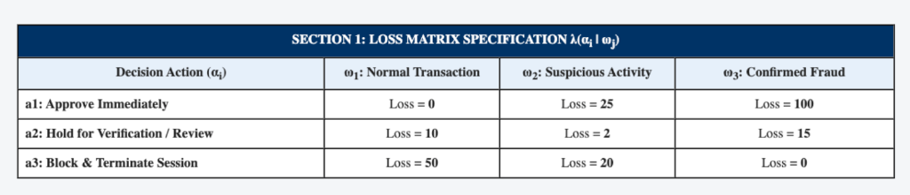
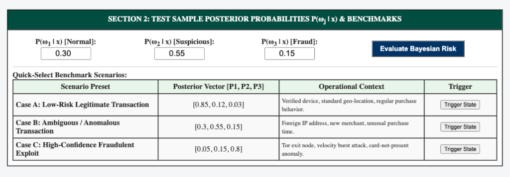
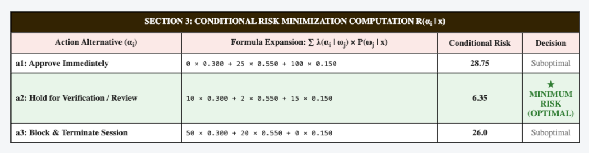
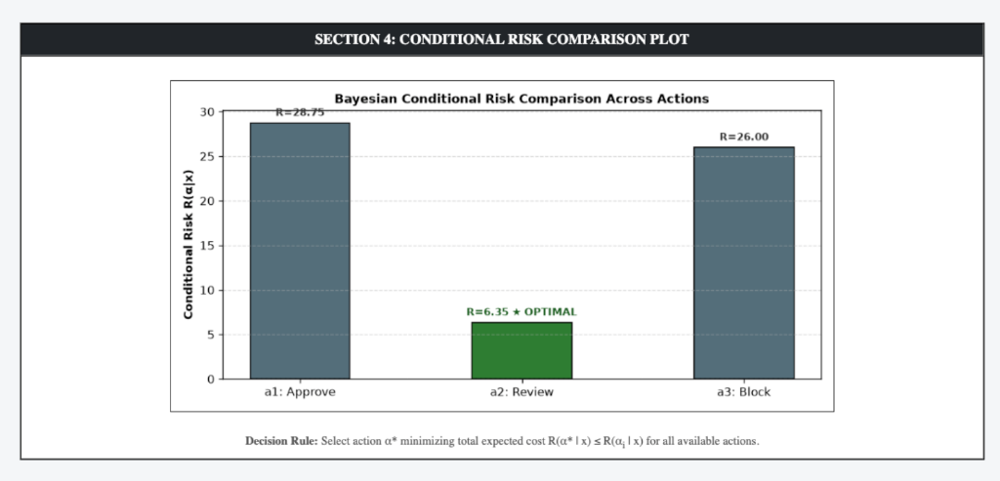

# PATTERN ANALYSIS AND RECOMMENDER SYSTEMS (PARS) LAB MANUAL

---

## EXPERIMENT 6

### PRACTICAL NAME:
**Bayesian Risk Minimization for Three Classes and Three Actions Using Flask**

---

### AIM:
To formulate, implement, and deploy an interactive Flask web application to perform Bayesian Risk Minimization for a pattern classification problem consisting of at least three classes (&omega;<sub>1</sub>, &omega;<sub>2</sub>, &omega;<sub>3</sub>) and three permissible operational actions (&alpha;<sub>1</sub>, &alpha;<sub>2</sub>, &alpha;<sub>3</sub>). Given a user-defined loss matrix, the system calculates conditional risk for each action, triggers the minimum-risk action, and reflects the decision and risk landscape dynamically in the web interface.

---

### DEFINITIONS & CORE CONCEPTS:
* **Bayesian Decision Theory & Risk:** In real-world problems, different misclassification errors carry unequal costs (e.g., failing to detect a critical disease vs. a false alarm). Bayesian Risk Minimization integrates asymmetric loss matrices to minimize expected loss.
* **Loss Matrix Lambda:** A matrix where lambda(alpha_i | omega_j) defines the penalty of selecting action alpha_i when the true state of nature is omega_j.
* **Conditional Risk R(alpha_i | x):</b> The expected loss of action alpha_i for sample x, computed as the weighted sum of losses over posterior class probabilities.

---

### MATHEMATICAL FORMULATIONS:
#### 1. Conditional Risk (Expected Loss)
```text
R(alpha_i | x) = sum_{j=1}^3 lambda(alpha_i | omega_j) * P(omega_j | x)

Where:
• alpha_i in { alpha_1, alpha_2, alpha_3 } is the candidate action.
• omega_j in { omega_1, omega_2, omega_3 } is the true state of nature.
• lambda(alpha_i | omega_j) is the loss incurred by taking action alpha_i when truth is omega_j.
• P(omega_j | x) is the posterior probability of class omega_j.
```

#### 2. Loss Matrix Specification
```text
Lambda = [ [ lambda_11, lambda_12, lambda_13 ],
           [ lambda_21, lambda_22, lambda_23 ],
           [ lambda_31, lambda_32, lambda_33 ] ]
```

#### 3. Minimum Risk Decision Rule
```text
alpha^* = argmin_{i in {1, 2, 3}} R(alpha_i | x)
```

---

### ALGORITHMIC METHODOLOGY & IMPLEMENTATION STEPS:
1. Defined a 3-class, 3-action clinical / operational decision domain with verifiable asymmetric loss penalties.
2. Implemented posterior probability ingestion accepting observation vectors and normalizing evidence.
3. Coded pure NumPy matrix multiplication evaluating conditional risk vectors R across all candidate actions.
4. Programmed threshold logic triggering the optimal minimum-risk action and highlighting affected UI states.
5. Deployed interactive Flask dashboard on port 5002 with editable loss matrices, probability sliders, and risk comparison plots.

---

### EXPERIMENTAL RESULTS & VISUAL VERIFICATION:
#### Figure 6.1: Configurable 3x3 Loss Matrix
Interactive matrix input displaying asymmetric cost values for all 9 action-state combinations.



#### Figure 6.2: Posterior Probability Sliders & Inputs
Dynamic controls allowing adjustment of posterior class probabilities satisfying the unit-sum constraint.



#### Figure 6.3: Computed Conditional Risks & Minimum-Risk Decision
Table displaying expected losses R(alpha_i|x) for each action and highlighting the triggered optimal action.



#### Figure 6.4: Action Risk Landscape Bar Chart
Comparative bar plot illustrating the risk disparity between conservative, moderate, and aggressive actions.



---

### CONCLUSION:
Experiment 6 demonstrated the critical importance of Bayesian Risk Minimization in asymmetric decision environments. By incorporating non-uniform loss matrices, the application illustrated how an action associated with a lower posterior probability can be rationally chosen if alternative choices carry catastrophic error penalties, successfully operationalizing the principle of minimum expected risk.
