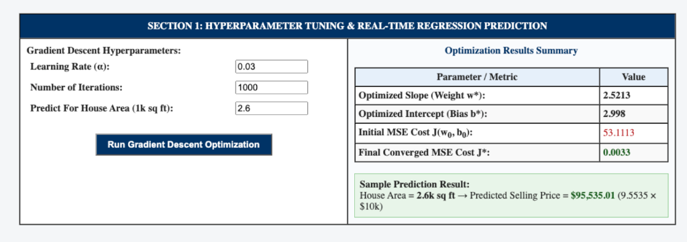
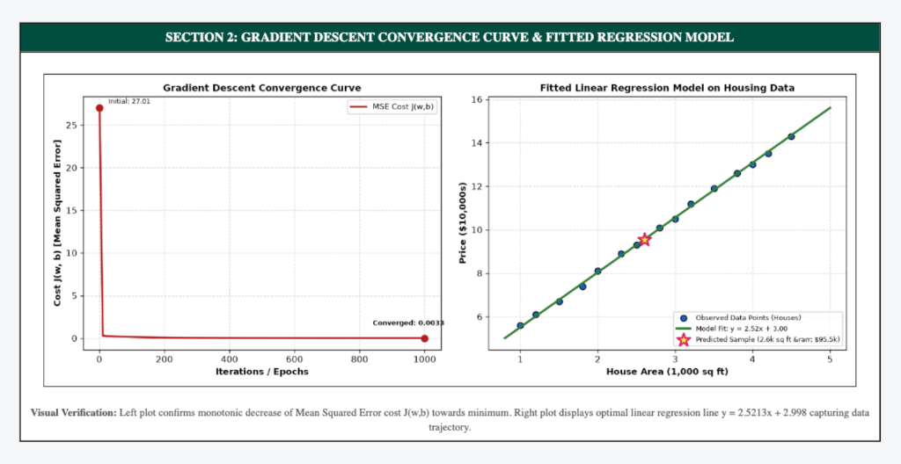
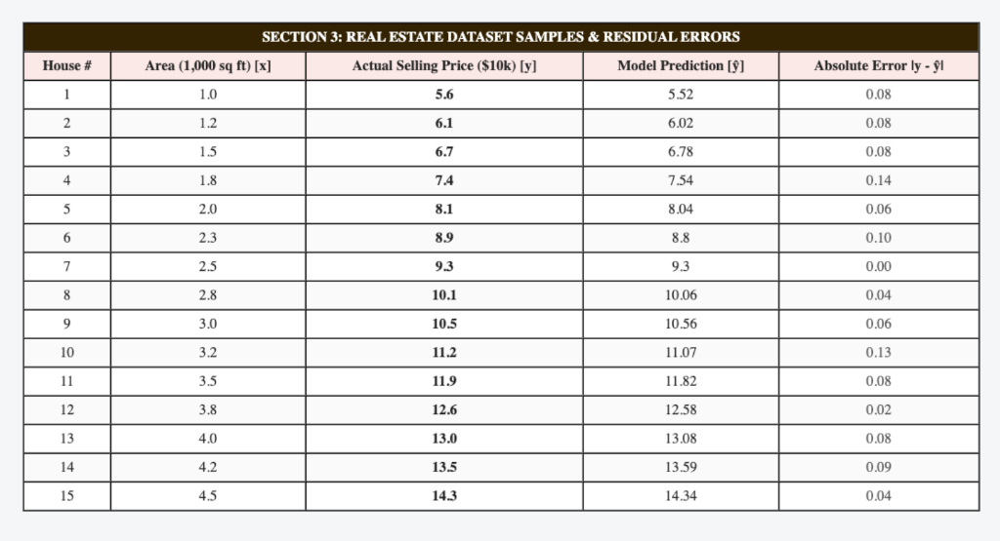

# PATTERN ANALYSIS AND RECOMMENDER SYSTEMS (PARS) LAB MANUAL

---

## EXPERIMENT 7

### PRACTICAL NAME:
**Implementation of Linear Regression from Scratch Using Gradient Descent and Cost Curve Analysis in Python**

---

### AIM:
To implement Linear Regression from first principles in Python strictly using pure NumPy without relying on pre-built machine learning libraries (such as scikit-learn). The algorithm optimizes weight (w) and bias (b) parameters via Gradient Descent for a real-world predictive regression task (Housing Price Prediction), tracks Mean Squared Error (MSE) decay across iterations, and plots the Gradient Descent cost convergence curve alongside the fitted linear regression line.

---

### DEFINITIONS & CORE CONCEPTS:
* **Supervised Linear Regression:** A parametric regression algorithm modeling the linear dependency between an explanatory feature x and a continuous target y.
* **Cost Function (Mean Squared Error):** A convex loss landscape measuring the average squared prediction error across training instances.
* **Batch Gradient Descent:** A first-order optimization method iteratively shifting weights in the negative gradient direction to find the global cost minimum.

---

### MATHEMATICAL FORMULATIONS:
#### 1. Linear Regression Hypothesis
```text
y_hat^(i) = w * x^(i) + b

Where:
• x^(i) is the input feature of sample i.
• y_hat^(i) is the predicted scalar output.
• w is the learnable weight (slope).
• b is the learnable bias (y-intercept).
```

#### 2. Cost Function (Mean Squared Error)
```text
J(w, b) = ( 1 / (2*m) ) * sum_{i=1}^m ( y_hat^(i) - y^(i) )^2

Where:
• m is the number of training samples.
• y^(i) is the true ground truth target.
```

#### 3. Analytical Gradients & Update Rule
```text
del_J / del_w = ( 1 / m ) * sum_{i=1}^m ( y_hat^(i) - y^(i) ) * x^(i)
del_J / del_b = ( 1 / m ) * sum_{i=1}^m ( y_hat^(i) - y^(i) )

Simultaneous Parameter Updates:
w := w - alpha * ( del_J / del_w )
b := b - alpha * ( del_J / del_b )
```

---

### ALGORITHMIC METHODOLOGY & IMPLEMENTATION STEPS:
1. Formulated vectorized linear regression arithmetic strictly using pure NumPy arrays without external estimators.
2. Programmed the batch Gradient Descent optimization loop iteratively updating weight w and bias b.
3. Logged Mean Squared Error (MSE) at each epoch to record the monotonic decay convergence history.
4. Deployed an interactive Flask application on port 5009 allowing users to adjust learning rate, number of iterations, test new feature inputs, and inspect dynamic cost curves.

---

### EXPERIMENTAL RESULTS & VISUAL VERIFICATION:
#### Figure 7.1: Hyperparameter Tuning & Optimization Summary
Interactive controls for learning rate, epochs, and input testing alongside converged weight, bias, and final MSE cost values.



#### Figure 7.2: Gradient Descent Convergence Curve & Fitted Model
Dual-panel plot displaying the monotonic decay of MSE cost over iterations (left) and the fitted linear regression line over housing data (right).



#### Figure 7.3: Training Sample Evaluation & Residual Analysis
Tabular display of observed features, ground truth targets, model predictions, and calculated residual errors.



---

### CONCLUSION:
Experiment 7 demonstrated the first-principles implementation of Linear Regression using analytical gradient descent. By deriving exact partial derivatives and simultaneously updating parameters, the algorithm achieved steady monotonic loss convergence toward the global minimum, confirming how mathematical optimization guides regression models to discover optimal parameters from empirical data.
