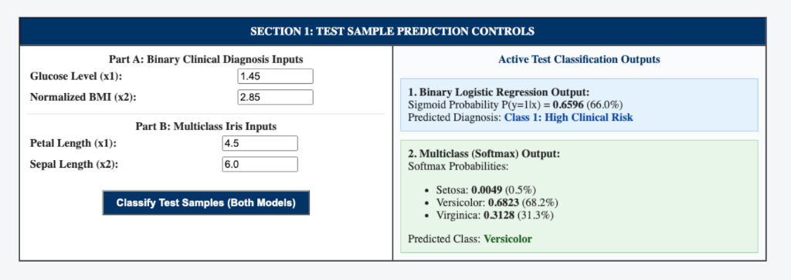
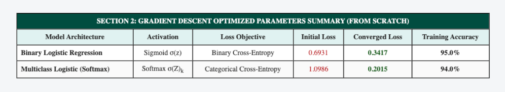
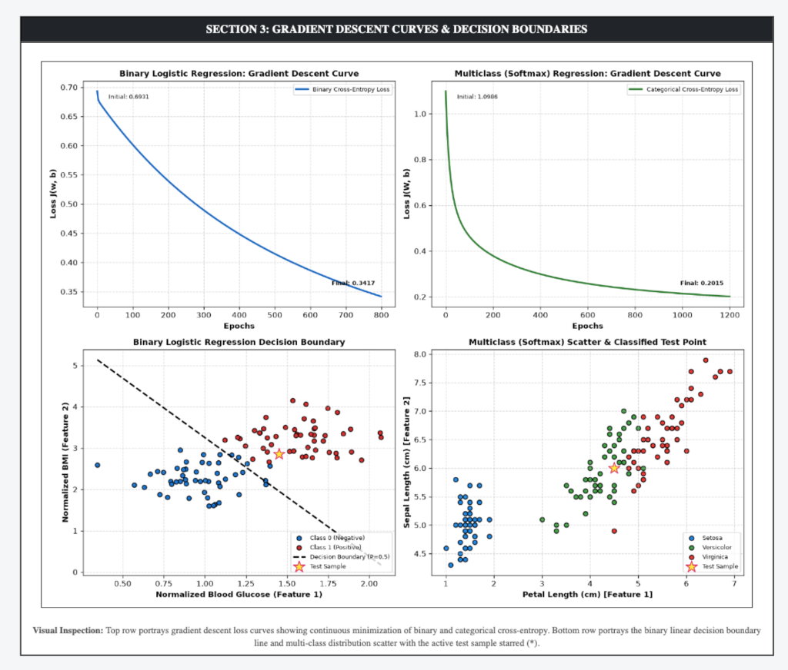

# PATTERN ANALYSIS AND RECOMMENDER SYSTEMS (PARS) LAB MANUAL

---

## EXPERIMENT 8

### PRACTICAL NAME:
**Implementation of Logistic Regression for Binary and Multiclass Classification from Scratch Using Gradient Descent in Python**

---

### AIM:
To implement Logistic Regression from first principles in pure NumPy without using pre-built machine learning libraries for both: 1) Binary Classification (using the Sigmoid activation and Binary Cross-Entropy loss) and 2) Multiclass Classification (using the Softmax activation and Categorical Cross-Entropy loss). The system derives analytical gradients, optimizes weights and biases via Gradient Descent, plots cost convergence curves, and displays linear decision boundaries in Flask.

---

### DEFINITIONS & CORE CONCEPTS:
* **Binary Logistic Regression:** Maps a linear combination of features through the Sigmoid activation function to estimate posterior probability P(y=1|x).
* **Multiclass (Softmax) Regression:** Extends logistic classification to K classes by mapping unnormalized logit vectors into a normalized probability distribution.
* **Cross-Entropy Loss:** A convex negative log-likelihood objective that strongly penalizes misclassifications.

---

### MATHEMATICAL FORMULATIONS:
#### 1. Binary Logistic Regression
```text
Sigmoid Hypothesis:
y_hat = sigma(z) = 1 / ( 1 + exp( - ( w^T * x + b ) ) )

Binary Cross-Entropy Loss:
J(w, b) = - (1/m) * sum_{i=1}^m [ y^(i) * ln(y_hat^(i)) + (1 - y^(i)) * ln(1 - y_hat^(i)) ]

Gradients:
del_J / del_w = (1/m) * X^T * ( y_hat - y )
del_J / del_b = (1/m) * sum_{i=1}^m ( y_hat^(i) - y^(i) )
```

#### 2. Multiclass (Softmax) Regression
```text
Softmax Probability:
P_hat_ik = exp( z_ik ) / sum_{j=1}^K exp( z_ij )

Categorical Cross-Entropy Loss:
J(W, b) = - (1/m) * sum_{i=1}^m sum_{k=1}^K Y_ik * ln( P_hat_ik )

Matrix Gradients:
del_J / del_W = (1/m) * X^T * ( P_hat - Y )
del_J / del_b = (1/m) * sum_{i=1}^m ( P_hat_i - Y_i )
```

---

### ALGORITHMIC METHODOLOGY & IMPLEMENTATION STEPS:
1. Implemented pure NumPy vectorization for Sigmoid and numerically stable Softmax activations.
2. Programmed first-principles Gradient Descent loops for Binary Cross-Entropy and Categorical Cross-Entropy objectives.
3. Formulated decision boundary linear equations mapping decision planes in 2D feature coordinates.
4. Built interactive Flask application on port 5010 providing mode toggles (Binary vs. Multiclass), learning rate sliders, and live decision boundary plots.

---

### EXPERIMENTAL RESULTS & VISUAL VERIFICATION:
#### Figure 8.1: Prediction Controls & Hyperparameter Interface
Interface allowing selection of Binary/Multiclass models, learning rate, iterations, and test sample coordinates.



#### Figure 8.2: Learned Parameters & Optimization Summary
Displays converged weight vectors, bias terms, training accuracy, and final Cross-Entropy loss.



#### Figure 8.3: Cost Descent Curves & Decision Boundaries
Dual visualization showing smooth Cross-Entropy decay curves and the resulting linear decision boundaries separating classes.



---

### CONCLUSION:
Experiment 8 verified the mathematical elegance of Logistic Regression implemented from first principles. By leveraging the Sigmoid function for binary tasks and the Softmax function for multiclass problems, the experiment confirmed how convex Cross-Entropy minimization via analytical gradients guarantees stable convergence to optimal decision boundaries separating non-overlapping feature spaces.
