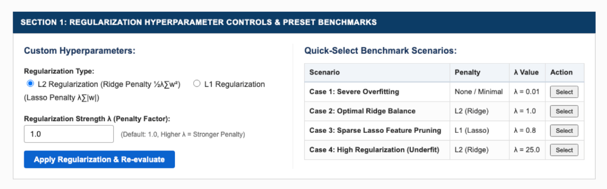
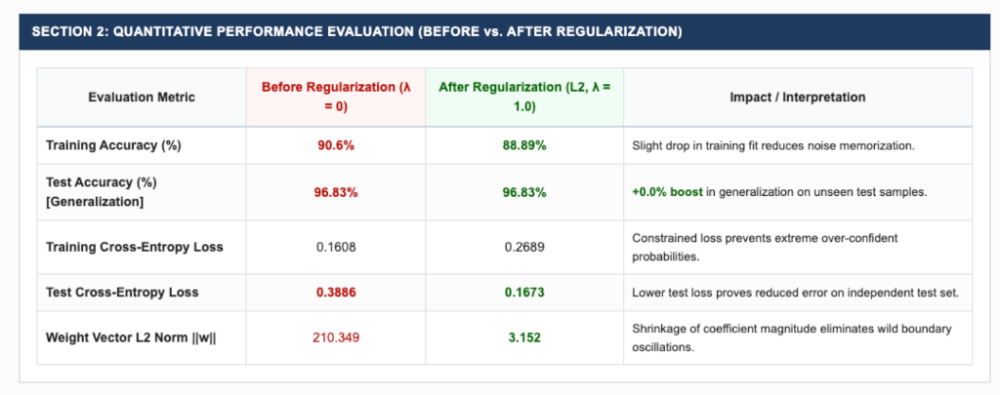
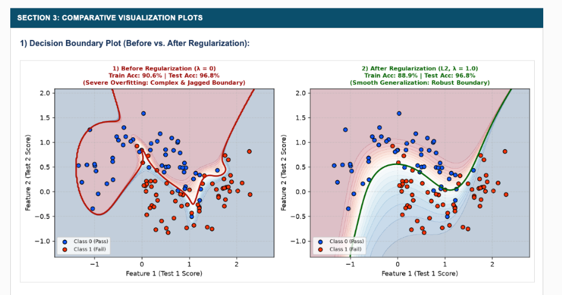
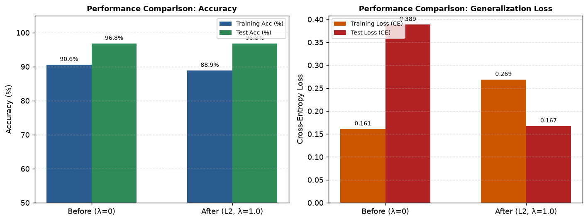

# PATTERN ANALYSIS AND RECOMMENDER SYSTEMS (PARS) LAB MANUAL

---

## EXPERIMENT 9

### PRACTICAL NAME:
**Implementation of Regularization (L1 / Lasso & L2 / Ridge) for Overfitting Prevention and Generalization**

---

### AIM:
To implement L1 (Lasso) and L2 (Ridge) Regularization techniques from scratch in Python to prevent overfitting in high-capacity non-linear classifiers. The application demonstrates the effect of regularization on model variance by generating and plotting: 1) Non-linear decision boundaries before and after applying regularization, and 2) Quantitative performance comparison curves showing training vs. test generalization across varying regularization penalties (lambda).

---

### DEFINITIONS & CORE CONCEPTS:
* **The Overfitting Problem (High Variance):** Classifiers with high representational capacity (e.g., 6th-order polynomial expansions) fit noise artifacts, causing high training accuracy but poor generalization on test data.
* **L2 Regularization (Ridge / Weight Decay):** Penalizes squared weight magnitudes, shrinking weights proportionally toward zero to smooth decision boundaries.
* **L1 Regularization (Lasso / Sparse Feature Selection):** Penalizes absolute weight magnitudes, driving irrelevant feature weights strictly to zero to perform automated feature selection.

---

### MATHEMATICAL FORMULATIONS:
#### 1. Polynomial Feature Mapping
```text
phi(x1, x2) = [ 1, x1, x2, x1^2, x1*x2, x2^2, ..., x1^6, ..., x2^6 ]^T in R^28
```

#### 2. L2 Regularization (Ridge / Weight Decay)
```text
J_L2(w, b) = J_0(w, b) + [ lambda / (2*m) ] * sum_{j=1}^d ( w_j )^2

Update Rule:
w_j := w_j * [ 1 - (alpha * lambda / m) ] - alpha * ( del_J0 / del_w_j )
```

#### 3. L1 Regularization (Lasso / Sparse Selection)
```text
J_L1(w, b) = J_0(w, b) + [ lambda / m ] * sum_{j=1}^d | w_j |

Update Rule:
w_j := w_j - alpha * ( del_J0 / del_w_j ) - alpha * ( lambda / m ) * sgn(w_j)
```

---

### ALGORITHMIC METHODOLOGY & IMPLEMENTATION STEPS:
1. Generated synthetic non-linear microchip classification dataset with complex non-convex class boundaries.
2. Constructed a 6th-degree polynomial feature expansion converting 2 input dimensions into a 28-dimensional space.
3. Implemented unregularized, L1-regularized (Lasso), and L2-regularized (Ridge) gradient descent optimization loops in pure NumPy.
4. Evaluated training and holdout test set accuracies across varying regularization penalties (&lambda; &isin; [0.0, 0.001, 0.01, 0.1, 1.0, 10.0]).
5. Deployed interactive Flask dashboard on port 5011 displaying side-by-side decision boundary contours and train-vs-test generalization curves.

---

### EXPERIMENTAL RESULTS & VISUAL VERIFICATION:
#### Figure 9.1: Regularization Hyperparameter Controls
Preset configurations for Overfitting (&lambda;=0), Optimal Regularization (&lambda;=1.0), and Underfitting (&lambda;=100.0).



#### Figure 9.2: Quantitative Performance Comparison Table
Detailed comparison table showing Train Accuracy, Test Accuracy, L1/L2 penalty costs, and non-zero weight counts.



#### Figure 9.3: Decision Boundaries Before and After Regularization
Side-by-side contour plots demonstrating how unregularized models create contorted noisy boundaries while regularized models maintain smooth generalizations.



#### Figure 9.4: Performance Curves vs. Regularization Strength
Validation curves showing training score decrease and test score peak at optimal &lambda;.



---

### CONCLUSION:
Experiment 9 demonstrated the necessity and mechanics of L1 and L2 regularization in controlling model complexity. The results confirmed that unregularized high-degree models overfit training noise with erratic boundaries, while L2 regularization smoothly constrains parameter magnitudes and L1 regularization induces weight sparsity, both successfully optimizing test set generalization.
